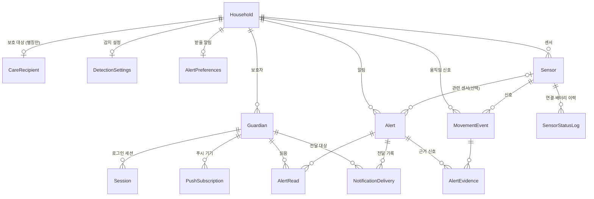

# 데이터 구조 (Prisma · SQLite)

스키마는 [`apps/server/prisma/schema.prisma`](../apps/server/prisma/schema.prisma), 마이그레이션은 `apps/server/prisma/migrations/`(손으로 검토한 SQL)입니다. Prisma Client는 `apps/server/src/generated/prisma`에 생성됩니다(`npm run db:generate`).

## 초안과 현재 구조의 관계

요청한 초안(User·CareRecipient·CaregiverAccess·Sensor·MotionEvent·Notification·NotificationDelivery·MonitoringSettings)은 **이미 구현된 모델과 대부분 같은 역할**입니다. 같은 일을 하는 모델을 새로 만들면 데이터가 둘로 갈라지므로, **이름을 바꾸거나 복제하지 않고** 빠진 것만 보강했습니다.

| 초안 | 현재 모델 | 비고 |
|---|---|---|
| User | `Guardian` | email(유일·소문자)·passwordHash·displayName·createdAt·**updatedAt(추가)**. 역할 `role` |
| CareRecipient | `CareRecipient` | `displayName`→`alias`(별칭만), `notes`→`memo`(선택, 200자). **updatedAt 추가** |
| CaregiverAccess | `Guardian.householdId` + `role` | 접근 범위의 단위가 **가구(Household)** 입니다. 아래 "접근 범위" 참고 |
| Sensor | `Sensor` | `location`→`zone`(열거형), `type`→`kind`, `enabled`→`isActive`, `batteryLevel`→`batteryPercent`(수준은 설정 기준으로 계산), **`deviceId`·`updatedAt` 추가**, `provider`→`origin`(REAL/SIMULATED) |
| MotionEvent | `MovementEvent` | 원본 신호(불변) + 받을 때 정한 분류 `eventClass`. 심각도는 저장하지 않음 — 아래 참고 |
| Notification | `Alert` + `AlertRead` | 보호자마다 다른 읽음(`readAt`)은 `AlertRead`로 분리 |
| NotificationDelivery | `NotificationDelivery` | 채널·상태·시도 횟수·시각. **인덱스 추가** |
| MonitoringSettings | `DetectionSettings` + `AlertPreferences` | 사용 여부·요일(비트마스크)·시작/종료·민감도·반복 억제 시간 |

### 일부러 추가하지 않은 것

| 초안 항목 | 이유 |
|---|---|
| `CaregiverAccess` (보호자 ↔ 보호 대상 다대다) | 지금 서비스는 "한 가구 = 보호 대상 1명 + 보호자 여러 명"입니다. 센서·기록·설정이 모두 `householdId`로 묶여 있어, 다대다로 바꾸면 모든 테이블과 접근 검사를 고쳐야 합니다. 보호 대상이 여러 명인 요구가 생기면 그때 `householdId`를 `careRecipientId`로 바꾸는 이전을 설계합니다. (아직 계정 추가·다중 가구도 없음) |
| `MotionEvent.severity` · `metadata` | 주의 수준·설명은 **원본에서 계산**합니다(`domain/timeline.ts`). 저장하면 규칙·설정이 바뀔 때 과거 기록과 어긋납니다. 신호 자체에는 위험도가 없습니다. (이벤트 **유형**은 `eventClass`로 저장합니다. 받을 때의 규칙으로 정한 분류라 이후 설정 변경에도 과거 기록이 바뀌지 않습니다.) 장치가 보내는 부가 정보(`metadata`)는 아직 수집 계약에 없어 만들지 않았습니다. |
| `Sensor.provider` | 지금은 모든 센서가 HTTP 수집 API로 신호를 보냅니다. 구분이 필요한 것은 실제/시뮬레이션뿐이라 `origin`이 그 역할입니다. 다른 연결 방식이 생기면 그때 추가합니다. |
| `NotificationDelivery.completedAt` · `errorCode` | 성공 시각은 `sentAt`, 실패 이유는 `lastError`가 이미 있고, 오류 코드를 채우는 코드가 아직 없습니다. 채울 곳이 없는 열은 만들지 않았습니다. |
| `MonitoringSettings.timezone` | 서비스 전체가 한국 시간(Asia/Seoul)으로 고정되어 있고, 규칙 엔진·화면이 모두 그 가정을 씁니다. 열만 추가하면 값을 바꿔도 동작하지 않는 장식이 됩니다. 설정 화면은 "한국 표준시(고정)"으로 표시합니다. |
| `User.role`(전역) · `Notification.userId` | 알림은 가구의 것이고, 읽음·전달은 보호자별로 `AlertRead`·`NotificationDelivery.guardianId`에 기록합니다. |

## 관계도



## 모델 요약

| 모델 | 핵심 열 | 제약·인덱스 |
|---|---|---|
| `Household` | name, setupCompletedAt, onboardingStep, createdAt/updatedAt | — |
| `Guardian` | householdId, email, passwordHash, displayName, role(OWNER/MEMBER), createdAt/updatedAt | **email 유일**, (householdId) |
| `CareRecipient` | householdId, alias, memo, createdAt/updatedAt | **householdId 유일**(가구당 1명) |
| `DetectionSettings` | monitoringEnabled, activeWeekdays(비트마스크), nightStart/End, sensitivity, 반복·재알림·끊김·배터리 기준, retentionDays, updatedAt | 기본키 = householdId |
| `AlertPreferences` | 알림 종류별 켜짐(5+1), updatedAt | 기본키 = householdId |
| `NotificationDelivery.channel` | `Channel` 값: `IN_APP` `WEB_PUSH` `WATCH` `SMS` `KAKAO` (`WATCH` 추가는 SQLite 에서 스키마 변경이 없어 마이그레이션 SQL 이 비어 있음) |
| `Sensor` | householdId, **deviceId?**, lastHeartbeatAt?, offlineAfterSeconds?, receiveErrorCount/lastReceiveErrorAt/lastReceiveError (센서 상태 — [SENSOR_HEALTH.md](SENSOR_HEALTH.md)), name, kind, zone, origin, tokenHash, isActive, lastSeenAt, batteryPercent, sensitivity?, createdAt/updatedAt | **tokenHash 유일**, **(householdId, deviceId) 유일**, (householdId, zone) |
| `SensorStatusLog` | sensorId, at, kind, detail | (sensorId, at) |
| `MovementEvent` | householdId, sensorId, zone, origin, deviceEventId, occurredAt, receivedAt, isLate | **(sensorId, deviceEventId) 유일**(재전송 방지), (householdId, occurredAt), (sensorId, occurredAt) |
| `Alert` | householdId, type, severity, status, origin, title, message, sensorId?, 시각·확인·종료 정보, dedupeKey | (householdId, status, triggeredAt), (householdId, dedupeKey) |
| `AlertEvidence` | alertId, eventId | 기본키 (alertId, eventId) |
| `AlertRead` | alertId, guardianId, readAt | 기본키 (alertId, guardianId), (guardianId) |
| `AlertClip` | alertId, householdId, mimeType, sizeBytes, durationMs?, **data(영상 바이트)**, createdAt | (alertId, createdAt), (createdAt). 시연용 웹캠 알림 영상. 마이그레이션 `20261122120000_alert_clips` |
| `NotificationDelivery` | alertId, guardianId, channel, providerMode, status, attempts, lastError, nextAttemptAt, sentAt | (alertId), **(guardianId)**, **(status, nextAttemptAt)** |
| `PushSubscription` | guardianId, endpoint, 암호화 키 | **endpoint 유일**, (guardianId) |
| `Session` | id(토큰의 SHA-256), guardianId, expiresAt | (guardianId), (expiresAt) |

### 열거형·타입 (SQLite 제약)

- Prisma의 `enum`은 SQLite에서 **문자열(TEXT) 열**로 저장되고, 값 검사는 Prisma Client가 합니다(DB 자체에는 CHECK가 없음). 같은 값 목록이 `packages/shared/src/domain.ts`에도 있어 **두 목록이 어긋나면 `db/schema.test.ts`가 실패**합니다.
- SQLite에는 배열 열이 없습니다. 모니터링 요일은 **정수 비트마스크**(월=1 … 일=64, 기본 127=매일)로 저장하고, 공유 패키지의 `weekdaysToMask`/`maskToWeekdays`로 변환합니다. 이 방식은 PostgreSQL에서도 그대로 동작합니다.
- 시각은 `DateTime`(UTC)이며 화면에서 한국 시간으로 보여 줍니다. JSON 열·Decimal은 쓰지 않았습니다.
- ID는 `cuid()` 문자열입니다.

## 접근 범위 (인증 사용자의 데이터)

- **모든 사용자 데이터에 `householdId`가 있고**, 서버는 요청마다 **세션에서 찾은 보호자의 가구**로만 조회·수정합니다. 클라이언트가 보낸 가구/사용자 ID는 신뢰하지 않으며, 다른 가구의 항목은 404로 응답합니다(존재 여부를 알려 주지 않음). `modules/*/*.test.ts`의 "다른 가구" 테스트가 이를 확인합니다.
- 읽음·전달·푸시 기기는 **보호자별**(`guardianId`)로 따로 저장합니다.
- 세션 토큰은 원문을 저장하지 않고 SHA-256 해시만 저장합니다. 장치 토큰도 같습니다(`Sensor.tokenHash`, 원문은 발급 시 한 번만 보여 줌). `deviceId`는 장치를 알아보는 용도일 뿐 **인증에 쓰지 않습니다**.

## 삭제 시 연관 데이터 처리

| 지우는 것 | 함께 지워지는 것 (Cascade) | 남는 것 |
|---|---|---|
| `Household` | 보호자·보호 대상·설정·받을 알림·센서·움직임 기록·알림 전부 | 다른 가구 |
| `Guardian` | 세션·푸시 기기·읽음·전달 기록 | **알림 자체**(가구의 것) |
| `Sensor` | 그 센서의 움직임 기록·상태 이력 | **알림**은 남고 `sensorId`만 null(`SetNull`) — 이미 보낸 알림이 사라지지 않게 |
| `Alert` | 근거 연결·전달 기록·읽음·**알림 영상** | **움직임 기록**(원본) |
| `MovementEvent` | 알림과의 근거 연결 | 알림 |

센서는 API에서 **먼저 "사용 안 함"으로 바꾼 뒤에만** 삭제할 수 있어, 실수로 기록을 잃지 않게 합니다. 외래키 무결성은 `db/crud.test.ts`가 확인합니다(`PRAGMA foreign_key_check` 포함).

## 이벤트 기록 보존 정책

- 가구별 **보관 기간 `retentionDays`** (7~365일, 기본 90일; 설정 → 감지 시간·민감도). 1시간마다 `MaintenanceService.purgeOldData()`가 지웁니다.
  - 지우는 것: 보관 기간이 지난 **움직임 기록**, 종료된(`RESOLVED`) 지 오래된 **알림**, 오래된 **센서 상태 이력**.
  - 지우지 않는 것: 아직 종료되지 않은 알림, 센서·설정·보호자 정보.
- 움직임 기록은 **수정하지 않습니다**(원본 불변). 알림·주의 수준·상태는 원본에서 파생되고, 이벤트 유형(`eventClass`)은 받을 때 정해 저장합니다.
- 시뮬레이션 데이터(`origin = SIMULATED`)는 설정 → 데이터 관리에서 따로 지울 수 있습니다. (알림 영상도 알림과 함께 지워짐)
- **알림 영상(`AlertClip`)은 7일**(`ALERT_CLIP_LIMITS.retentionDays`)이 지나면 같은 주기 정리에서 지웁니다. 영상은 DB 파일 안에 그대로(암호화 없이) 들어 있으므로 **백업 파일에도 포함**됩니다.
- 백업·복구는 [OPERATIONS.md](OPERATIONS.md)를 따릅니다.

## 개인정보 최소 수집

- **진단 정보·상세 의료 기록은 수집하지 않습니다.** 보호 대상은 **별칭(`alias`, 20자)만으로 등록**하고, 선택 메모(`memo`, 200자)에도 실명·연락처·병명을 적지 말라고 화면이 안내합니다.
- 테스트·시드 데이터는 모두 가상입니다(`demo@example.com`, "어르신(데모)", "(샘플)" 센서). 시드는 운영 환경에서 실행을 거부합니다.

## 마이그레이션

| 이름 | 내용 |
|---|---|
| `20261114035013_init` | 전체 초기 스키마 |
| `20261114045419_alert_lifecycle` | 알림 확인·종료·재알림·전달 |
| `20261114120000_household_setup` | 초기 설정 완료 시각 |
| `20261115120000_push_subscription` | 푸시 기기 |
| `20261117120000_alert_read` | 알림 읽음(보호자별) |
| `20261118120000_onboarding` | 초기 설정 단계·보호 대상 메모·받을 알림 |
| `20261119120000_settings_page` | 모니터링 사용 여부·요일, 센서별 민감도, 배터리 알림 분리 |
| `20261119140000_db_review` | **updatedAt**(Household·Guardian·CareRecipient·Sensor), **Sensor.deviceId**(+가구 안 유일), 전달 기록 인덱스 2개 |

- 새 DB: `npm run db:deploy`(운영·E2E), 개발 중 스키마를 바꿀 때는 `npm run db:migrate`.
- `20261119140000_db_review`는 SQLite가 `ALTER TABLE`로 `CURRENT_TIMESTAMP` 기본값 열을 추가하지 못해 Prisma가 만든 **표 재구성** 스크립트입니다. 기존 행의 `updatedAt`은 생성 시각(`createdAt`)으로 채웁니다. 데이터가 있는 DB에 적용해 값이 채워지는 것과 적용 뒤 스키마 차이가 없는 것(`prisma migrate diff` 결과가 비어 있음)을 확인했습니다.

## PostgreSQL로 옮길 때 고려할 점

- `provider`를 `postgresql`로 바꾸고 `DATABASE_URL`과 어댑터(`@prisma/adapter-better-sqlite3` → `@prisma/adapter-pg`)를 바꿉니다. **기존 마이그레이션 SQL은 SQLite 방언이라 그대로 쓸 수 없으므로**, 새 DB에서 `prisma migrate dev`로 초기 마이그레이션을 다시 만드는 것이 안전합니다. 데이터 이전은 별도 스크립트가 필요합니다.
- 열거형은 네이티브 `ENUM`이 됩니다(값 추가는 마이그레이션 필요).
- 유일 제약의 `NULL`: `(householdId, deviceId)`는 SQLite·PostgreSQL 모두 `deviceId`가 `NULL`인 행끼리 충돌하지 않습니다(테스트로 확인한 SQLite 동작과 PostgreSQL 표준이 같음).
- 이메일은 서버가 소문자로 정규화해 저장하므로 대소문자 비교 차이가 없습니다.
- 요일 비트마스크·`cuid` ID·UTC 시각은 그대로 호환됩니다. 동시 쓰기가 많아지면 `Alert` 중복 방지(`dedupeKey` 검사 후 생성)를 트랜잭션·유일 제약으로 더 단단히 할 수 있습니다.

## 샘플 개발 데이터

```bash
npm run db:seed
```

데모 가구·보호자(`demo@example.com`, 비밀번호는 `SEED_DEMO_PASSWORD`)와 **시뮬레이션 센서 3개**(침대 옆·복도·현관문, 장치 번호 `demo-*-01`), 최근 사흘 밤의 움직임 기록 9건을 만듭니다. 여러 번 실행해도 같은 결과이며, 센서가 이미 있으면 건드리지 않습니다.

## 검증

- `db/schema.test.ts` — Prisma enum ↔ 공유 상수, DB 기본값 ↔ 공유 기본 설정
- `db/crud.test.ts` — 모델별 생성·조회·수정·삭제, updatedAt 갱신, 유일성(이메일·토큰·장치 번호·이벤트 재전송), 외래키, 열거형 거부, 삭제 연쇄 정책, 인덱스 존재, 외래키 검사
- `modules/sensors/sensors.deviceid.test.ts` — 장치 번호 API(중복 409·검증 400)
