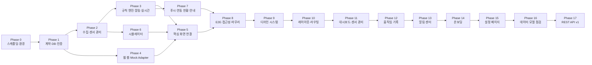

# 노크 구현 계획서

> 치매 노인 야간 안전 모니터링 및 보호자 알림 서비스 — MVP 구현 계획
> 작성일: 2026-11-13 · 상태: **Phase 17 완료 — MVP 구현 완료 + 디자인 시스템 + 레이아웃·라우팅 + 대시보드·센서 관리 + 움직임 기록 + 알림 센터 + 온보딩 + 설정 페이지 + 데이터 모델 점검 + REST API v1** · 버전: 1.6 · 변경 내역은 맨 아래 "문서 변경 이력"

이 문서는 구현 전에 합의해야 할 구조, 범위, 순서를 정리한다. 구현 중 결정이 바뀌면 이 문서를 먼저 고친다.

---

## 1. 현재 프로젝트 상태

| 항목 | 내용 |
|---|---|
| 작업 디렉터리 | 비어 있음 (파일 0개, Git 저장소 아님) |
| 기존 코드 | 없음 → **유지할 사항 없음**, 초기화로 지워질 것도 없음 |
| 개발 환경 | Node 26.8.2 · npm 11.19.1 · Git 2.50.1 (pnpm 없음 → **npm workspaces** 사용) |
| 이번 단계 산출물 | 이 문서만. 패키지 설치, 폴더 스캐폴딩, `git init`은 하지 않음 |

폴더 스캐폴딩을 미루는 이유: 작업 폴더가 임시 위치라서, 최종 프로젝트 위치가 정해진 뒤 Phase 0에서 한 번에 만드는 것이 안전하다.

---

## 2. 서비스 원칙 (구현 전반에 적용)

### 2.1 표현 원칙 — 확정적 판단 금지

이 서비스는 **움직임 신호를 알려 주는 도구**이며 낙상·배회를 예방하거나 확실히 감지하지 않는다. 개별 이벤트로 진단이나 사고 판정을 하지 않는다.

| 쓰지 않는 표현 | 쓰는 표현 |
|---|---|
| 낙상이 발생했습니다 | 침대 주변에서 움직임이 감지되었습니다. 상황을 확인해 주세요. |
| 배회 중입니다 | 짧은 시간 안에 여러 구역에서 움직임이 감지되었습니다. |
| 침대에서 이탈했습니다 | 침대 주변 센서에서 움직임 신호가 있었습니다. |
| 안전합니다 / 이상 없음 | 새로운 알림이 없습니다. 센서 3개가 모두 연결되어 있습니다. |
| 사고를 예방합니다 | 보호자가 확인하는 데 도움을 줍니다. |

- 센서가 꺼졌거나 연결이 끊겼으면 화면에 **"정상"을 절대 표시하지 않는다.** "모니터링 불완전" 상태로 보여 준다.
- 전체 화면에서 접근할 수 있는 `/notice`(서비스 안내와 한계)를 만들고, 초기 설정 마지막 단계에서 확인 체크를 받는다.

### 2.2 투명성 원칙 — 실패를 숨기지 않는다

- 센서 연결 끊김, 배터리 부족, 알림 전달 실패는 대시보드 상단에 항상 보이는 경고로 표시한다.
- 외부 서비스(SMS, 카카오 알림톡 등)는 `REAL`(실연동) / `MOCK`(가짜 응답) / `NOT_CONFIGURED`(미설정) 중 하나로 **화면에 명시**한다.
- 시뮬레이터가 만든 데이터는 `SIMULATED` 배지로 항상 구분한다.

### 2.3 개인정보 원칙

- 돌봄 대상은 **별칭**(예: "어르신")만 저장한다. 실명, 주소, 전화번호는 테스트 데이터에 쓰지 않는다.
- 시드 데이터는 명백한 가상 값 (`데모 보호자`, `demo@example.com`)을 쓴다.
- 카메라·마이크 등 영상/음성 수집은 하지 않는다 (움직임 신호만).
- 원본 이벤트 보관 기간 기본 90일, 이후 자동 삭제 (설정 가능).

---

## 3. 기술 스택과 호환성 확인

npm 레지스트리 기준 2026-11-13 조회 결과. 설치 시 `package-lock.json`으로 고정한다.

### 3.1 선택 버전

| 영역 | 패키지 | 버전 | 비고 |
|---|---|---|---|
| Front | react, react-dom | 19.3.1 | |
| | vite | 8.3.8 | |
| | @vitejs/plugin-react | 6.3.0 | peer `vite ^8` — Vite 8과 짝 |
| | tailwindcss, @tailwindcss/vite | 4.3.5 | Vite 플러그인 방식 (PostCSS 설정 불필요) |
| | react-router | 7.18.5 | v7은 `react-router` 패키지에서 import |
| | @tanstack/react-query | 5.107.1 | |
| | lucide-react | 1.72.0 | |
| | socket.io-client | 4.8.4 | 서버와 같은 4.8.x |
| Back | express, @types/express | 5.3.0 / 5.0.6 | Express 5는 async 핸들러 오류를 자동 전달 |
| | socket.io | 4.8.4 | |
| | **prisma, @prisma/client** | **7.10.1** | ⚠️ 아래 3.2 참고 |
| | @prisma/adapter-better-sqlite3 | 7.10.1 | Prisma 7의 SQLite 접근 방식 (Phase 1에서 설치, 세 패키지 모두 정확한 버전으로 고정) |
| | better-sqlite3 | (어댑터 의존성으로 자동 설치, 12.11.1) | 직접 설치하지 않는다 |
| | zod | 4.6.7 | 서버·클라이언트 공유 검증 |
| | tsx | 4.23.15 | 개발 서버 실행 |
| 공통 | typescript | **6.0.3** (`~6.0.3`) | 7.0.2는 typescript-eslint와 비호환 → 3.2 참고 |
| Test | vitest | 5.1.0 | Node ^22.12 / ^24 / ≥26 |
| | jsdom | 31.0.0 | Node ^22.22.2 / ^24.15 / ≥26 |
| | @testing-library/react | 16.3.3 | React 19 지원, `@testing-library/dom` 별도 설치 |
| | @playwright/test | 1.65.0 | 브라우저 다운로드가 커서 Phase 8에 설치 |

**Node 버전 기준:** 위 요구 조건의 교집합 → `engines.node: ">=24.15.0"`, `.nvmrc`는 `24`. 현재 환경(26.8.2)도 충족한다.

### 3.2 주의가 필요한 충돌·위험

1. **Prisma `latest` 태그가 RC(8.0.0-rc.33)다.** `npm install prisma`를 그냥 실행하면 RC가 설치된다. 안정 버전 **7.10.1**(`prev` 태그)로 명시해 고정한다. `prisma`와 `@prisma/client`는 반드시 같은 버전.
2. **TypeScript:** 최신 7.0.2는 `typescript-eslint`의 peer 조건(`typescript <6.1.0`)을 벗어난다. → **✅ Phase 0 결정: 6.0.3(`~6.0.3`)에 고정.** typescript-eslint가 7을 지원하면 올린다. 6.x부터 `types`의 기본값이 빈 배열이므로 각 tsconfig에서 `types`를 명시한다.
3. **SQLite enum:** → **✅ 확인됨.** Prisma 7.10.1 + SQLite에서 `enum` 사용 가능 (임시 폴더에서 스키마 → `db push` → 생성/조회까지 실행).
4. **Prisma 7 설정 방식:** → **✅ 확인됨.** `generator client { provider = "prisma-client", output = "../generated" }`, `datasource db { provider = "sqlite" }`(url 없음), `prisma.config.ts`의 `datasource: { url }`, `new PrismaClient({ adapter: new PrismaBetterSqlite3({ url }) })` 조합이 TS 6.0.3에서 타입 검사·실행 모두 통과했다. 사용하지 않는 의존성을 늘리지 않기 위해 **Phase 1에서 실제로 쓸 때 설치**한다.
5. **`better-sqlite3`는 네이티브 모듈:** → **✅ 확인됨.** 이 환경(macOS, Node 26.8.2)에서는 설치·실행 문제 없음. 다른 OS는 미확인.
6. **쿠키 인증 + Socket.IO:** 개발 중 포트가 다르면 쿠키·CORS 문제가 생기므로 Vite 프록시(`/api`, `/socket.io` → 서버)로 **같은 출처**를 유지한다. → **✅ Phase 0에서 구현.** 프록시를 통한 `/api/health`와 Socket.IO(WebSocket) 핸드셰이크 모두 확인.
7. **npm audit:** 개발 도구(ESLint → minimatch)에서 moderate 10건. 운영 의존성은 0건. 수정안이 ESLint 9로의 다운그레이드라 적용하지 않고 추적한다.

### 3.3 추가 라이브러리 (필요한 시점에만 설치)

| 패키지 | 용도 | 설치 시점 | 대안·메모 |
|---|---|---|---|
| supertest | API 통합 테스트 | Phase 2 | |
| pino | 서버 구조화 로그 | Phase 1 | `console` 직접 사용 금지 |
| helmet | 보안 헤더 | Phase 1 | |
| date-fns + @date-fns/tz | 날짜 표시 (Asia/Seoul) | Phase 4 | `Intl`만으로 충분하면 생략 |
| web-push | 브라우저 푸시 | Phase 7 | VAPID 키 필요 |
| eslint, prettier | 코드 품질 | Phase 0 | |
| concurrently | 서버+웹 동시 실행 | Phase 0 | npm workspaces 스크립트로 대체 가능 |
| @testing-library/user-event, jest-dom | 컴포넌트 테스트 | Phase 4 | |

**설치하지 않는 것:** 상태관리 라이브러리(서버 상태는 TanStack Query, UI 상태는 React 내장으로 충분), 차트 라이브러리(MVP는 CSS 막대로 시간대별 요약), 폼 라이브러리, 비밀번호 해시 패키지(Node 내장 `crypto.scrypt` 사용), MSW(Mock Adapter를 직접 구현).

---

## 4. MVP 범위

### 4.1 핵심 기능 분류

| # | 기능 | MVP 포함 | 후속 개발 |
|---|---|---|---|
| 1 | 실시간 모니터링 대시보드 | 상태 요약, 구역별 최근 움직임, 진행 중 알림, 센서 요약, 오늘 밤 타임라인 | 주간 리포트 |
| 2 | 센서 등록·관리 | 등록, 수정, 비활성화, 토큰 재발급, 구역 지정 | QR 페어링, 펌웨어 업데이트 |
| 3 | 움직임 구분 | 3개 구역: 침대 주변 / 이동 경로 / 현관 | 문 열림·압력 센서, 구역 사용자 정의 |
| 4 | 실시간 수신 | Socket.IO 이벤트 → 화면 즉시 갱신, 재연결 시 누락분 보충 | 다중 서버 인스턴스 (Redis 어댑터) |
| 5 | 위험 상황 알림 | 규칙 엔진, 앱 내 알림(소리·배너), 브라우저 푸시(선택) | SMS, 카카오 알림톡 (외부 연동) |
| 6 | 알림·움직임 기록 | 목록, 필터, 상세(근거 이벤트), 확인/종료/오알림 처리 | 내보내기(CSV) |
| 7 | 감지 시간·민감도 | 야간 시간대, 민감도 3단계, 알림 반복 억제 시간 | 요일별·구역별 개별 설정 |
| 8 | 센서 상태·배터리 | 연결 상태, 마지막 신호, 배터리 % | 신호 세기 추이 |
| 9 | 경고 | 연결 끊김, 배터리 부족, 알림 전달 실패 | 점검 안내 자동화 |
| 10 | 시뮬레이터 | 서버 모듈 + CLI + 웹 페이지 (시나리오 포함) | 부하 테스트 시나리오 |
| 11 | 확장 구조 | 수집 계약 문서화, 어댑터 인터페이스 | **실제 센서·스마트워치 연동 구현** |

### 4.2 MVP 제외 (명시)

다중 보호자 초대 UI, 스마트워치/웨어러블, 수면·활동 패턴 분석, 모바일 네이티브 앱, 다국어, 결제, 의료기관 연계, 영상·음성 수집.

### 4.3 가정 (확인이 필요하면 알려 주세요)

- **"감지 시간"**: 야간 모니터링 시간대(예: 22:00–06:00)와 규칙이 반응하는 시간 창(지속·반복 판단 기준)으로 해석했다.
- **인증**: 보호자 1명 이상이 이메일·비밀번호로 로그인하는 최소 인증을 MVP에 포함한다. (가구 1개 = 돌봄 대상 1명)
- **센서 종류**: 하드웨어는 미정이므로 "움직임 감지(PIR 계열) 신호를 HTTP로 보내는 장치"를 기준 계약으로 둔다.
- **시간대**: 서버 저장은 UTC, 화면 표시는 `Asia/Seoul` 고정.
- **배포**: 우선 단일 서버(로컬/홈서버/소형 VM) 1대. SQLite 단일 파일.

---

## 5. 화면과 라우팅

### 5.1 라우트

| 경로 | 화면 | 비고 |
|---|---|---|
| `/login` | 로그인 | 비로그인 시 모든 경로가 여기로. 서버에 보호자가 없으면 "첫 계정 만들기" 링크 |
| `/register` | 첫 계정 만들기 | 서버에 보호자가 한 명도 없을 때만 동작 (이후 계정은 이 경로로 만들 수 없음) |
| `/` | **대시보드** | 기본 화면 |
| `/onboarding` | 초기 설정 6단계(소개·보호 대상·센서·모니터링 시간·알림·확인). 단계마다 저장, 이어 하기, 마친 사용자는 다시 시키지 않음. 상세는 `docs/ONBOARDING.md` |
| `/notifications` | 알림 센터(목록) | 보기: 전체 / 읽지 않음 / 중요, 유형·처리 상태, 읽음 처리. 상세는 `docs/NOTIFICATIONS.md` |
| `/notifications/:alertId` | 알림 상세 | 근거 이벤트, 전달 결과, 확인·오알림 처리 |
| `/events` | 움직임 기록(타임라인) | 날짜·센서·이벤트 종류·주의 수준·알림 여부 필터, 날짜별 타임라인, 상세(`?event=`). 상세는 `docs/EVENTS.md` |
| `/sensors` | 센서 관리(목록) | 상태·배터리 한눈에 |
| `/sensors/new` | 센서 등록 | 등록 후 토큰 1회 표시 |
| `/sensors/:sensorId` | 센서 상세 | 최근 신호, 이벤트, 토큰 재발급, 비활성화 |
| `/settings` | 설정 (모니터링·감지·알림·서비스 네 구역, 구역별 저장) | 상세는 `docs/SETTINGS.md` |
| `/settings/detection` | 감지 시간·민감도 | |
| `/settings/notifications` | 알림 채널·테스트 발송 | 채널별 `REAL/MOCK/미설정` 표시 |
| `/settings/integrations` | 연동 현황 | |
| `/settings/data` | 데이터 관리 | 보관 기간, 시뮬레이션 데이터 삭제 |
| `/notice` | 서비스 안내와 한계 | 항상 접근 가능 |
| `/dev/simulator` | 센서 시뮬레이터 | `SIMULATOR_ENABLED=true`일 때만 노출 |
| `/alerts` `/alerts/:id` `/history` `/setup` | 예전 주소 | 각각 `/notifications` `/notifications/:id` `/events` `/onboarding` 로 넘김 (이미 발송된 푸시·북마크 호환) |
| `*` | 404 | |

### 5.2 레이아웃 (상세: `docs/LAYOUT_AND_ROUTING.md`)

- **모바일:** 하단 메뉴 5개 (홈 · 센서 · 기록 · 알림 · 설정), 터치 영역 56px. 세부 설정은 설정 화면에서 별도 페이지로 이동.
- **태블릿/데스크톱:** 좌측 **고정** 사이드바(로고·핵심 메뉴 4개, 맨 아래 설정·서비스 안내) + 헤더 + 본문. 두 단계 이상인 화면에만 이동 경로(Breadcrumbs).
- **헤더 (모든 화면):** 연결 상태(정상·연결 중·연결 끊김·확인 불가) · 센서 · 알림 전달 실패 · Mock/시뮬레이션 여부 · 알림 센터 버튼(확인 전 알림 수) · 계정.
- **연결이 끊기면** 이전 데이터를 현재 상태처럼 보여 주지 않는다: 맨 위 안내 + 센서 배지·알림 건수·대시보드 상태 카드를 "최신 아님"으로 바꾼다.
- 본문 글자 16px(브라우저 기본, rem 기반), 상태는 **색 + 아이콘 + 텍스트** 3가지로 표시.

### 5.3 대시보드 상태 (상세: `docs/DASHBOARD_AND_SENSORS.md`)

| 상태 | 문구 예 | 아이콘 | 조건 |
|---|---|---|---|
| 정상 | "최근 감지된 주의 이벤트가 없습니다" (안전 보장 문구 금지) | `CircleCheck` | 활성 센서 전부 연결, 열린 알림 없음 |
| 주의 | "센서 1개의 연결이 끊겨 있습니다" | `TriangleAlert` | 센서 일부 끊김·배터리 부족·첫 신호 대기·전달 실패 (알림 상태보다 항상 함께 표시) |
| 확인 필요 | "침대 주변에서 움직임이 감지되었습니다" | `TriangleAlert` / `BellRing` | 열린 알림(주의). 긴급이면 "즉시 확인 권장" 배지를 함께 |
| 연결 끊김 | "사용 중인 모든 센서의 연결이 끊겨 있습니다" | `WifiOff` | 센서 전부 끊김, 또는 이 화면이 서버와 연결되지 않음 |
| 상태 확인 불가 | "센서 상태를 확인하지 못했습니다" | `CircleHelp` | 정보를 불러오지 못함 |

화면 상태는 Loading · Success · Empty(센서 없음) · Error · Offline 다섯 가지다.

### 5.4 디자인 토큰 (초안)

- 배경 따뜻한 오프화이트, 본문 짙은 회갈색, 강조색은 차분한 청록 계열. 그라데이션·유리 효과·장식 그림자 없음.
- 상태색: 정상=녹색, 주의=호박색, 긴급=적색, 불완전=슬레이트. 색만으로 구분하지 않는다.
- 폰트: 시스템 한글 폰트(Apple SD Gothic Neo, Noto Sans KR, 맑은 고딕). Pretendard 자체 호스팅은 글꼴 파일이 커서 보류했다(필요한 굵기만 골라 나중에 추가). 기본 17px, 제목 22–28px.
- 토큰은 Tailwind v4 `@theme`에 CSS 변수로 정의 (`apps/web/src/styles/index.css`). 글자/배경 조합이 WCAG AA(4.5:1)를 만족하는지, 그라데이션·유리 효과가 없는지 `tokens.test.ts`가 검사한다.
- 문구 기준은 [COPY_GUIDE.md](COPY_GUIDE.md).

---

## 6. 데이터 모델 초안 (Prisma)

개념도:

```
Household ─┬─ Guardian(보호자) ── Session, PushSubscription
           ├─ CareRecipient(돌봄 대상, 별칭만)
           ├─ DetectionSettings (1:1)
           ├─ Sensor ──── MovementEvent
           │     └─ SensorStatusLog
           └─ Alert ─── AlertEvidence ── MovementEvent
                 └─ NotificationDelivery ── Guardian
```

```prisma
// apps/server/prisma/schema.prisma (초안 — Phase 1에서 확정)

enum ZoneKind      { BED_SIDE PATH ENTRANCE }
enum SensorKind    { MOTION }                 // 후속: DOOR, BED_PRESSURE, WEARABLE
enum DataOrigin    { REAL SIMULATED }
enum SensorState   { PENDING ONLINE OFFLINE DISABLED }   // 저장하지 않고 계산 + 전이 로그만 기록
enum Sensitivity   { LOW MEDIUM HIGH }
enum AlertType     { BED_AREA_ACTIVITY BED_TO_PATH ENTRANCE_APPROACH REPEATED_MOVEMENT SENSOR_OFFLINE LOW_BATTERY DELIVERY_FAILED }
enum AlertSeverity { INFO NOTICE URGENT }
enum AlertStatus   { OPEN ACKNOWLEDGED RESOLVED }
enum Resolution    { CHECKED FALSE_ALARM }
enum Channel       { IN_APP WEB_PUSH SMS KAKAO }
enum DeliveryStatus{ PENDING SENT FAILED NOT_CONFIGURED }
enum ProviderMode  { REAL MOCK }

model Household {
  id String @id @default(cuid())
  name String
  createdAt DateTime @default(now())
  // relations: guardians, recipient, settings, sensors, events, alerts
}

model Guardian {
  id String @id @default(cuid())
  householdId String
  email String @unique
  passwordHash String           // crypto.scrypt, salt 포함
  displayName String
  role String @default("OWNER") // 후속: MEMBER
  createdAt DateTime @default(now())
}

model Session {
  id String @id               // 랜덤 토큰의 해시
  guardianId String
  expiresAt DateTime
}

model CareRecipient {
  id String @id @default(cuid())
  householdId String @unique
  alias String                 // 실명 금지, "어르신" 등
}

model DetectionSettings {
  householdId String @id
  nightStart String @default("22:00")     // HH:mm, Asia/Seoul
  nightEnd String @default("06:00")       // 자정을 넘는 구간 지원
  sensitivity Sensitivity @default(MEDIUM)
  sequenceWindowMinutes Int @default(10)  // 침대→이동 경로 판단 시간 창
  cooldownMinutes Int @default(10)        // 같은 유형 알림 반복 억제
  reminderMinutes Int @default(5)         // 긴급 알림 미확인 시 재알림 간격
  offlineAfterSeconds Int @default(300)
  lowBatteryPercent Int @default(20)
  criticalBatteryPercent Int @default(10)
  retentionDays Int @default(90)
  updatedAt DateTime @updatedAt
}

model Sensor {
  id String @id @default(cuid())
  householdId String
  name String                  // "안방 침대 옆"
  kind SensorKind @default(MOTION)
  zone ZoneKind
  origin DataOrigin            // 시뮬레이터 센서는 SIMULATED
  tokenHash String @unique     // 장치 토큰은 해시만 저장, 원문은 발급 시 1회 표시
  isActive Boolean @default(true)
  lastSeenAt DateTime?
  batteryPercent Int?
  firmwareVersion String?
  createdAt DateTime @default(now())
  @@index([householdId, zone])
}

model SensorStatusLog {        // ONLINE↔OFFLINE, 배터리 구간 변화 이력
  id String @id @default(cuid())
  sensorId String
  at DateTime @default(now())
  kind String                  // CONNECTED | DISCONNECTED | BATTERY_LOW | BATTERY_CRITICAL | BATTERY_OK
  detail String?
  @@index([sensorId, at])
}

model MovementEvent {
  id String @id @default(cuid())
  householdId String
  sensorId String
  zone ZoneKind                // 센서 등록 구역을 이벤트 시점에 복사 (이후 센서 구역이 바뀌어도 기록 보존)
  origin DataOrigin
  deviceEventId String         // 장치가 만든 UUID — 중복 전송 방지
  occurredAt DateTime          // 장치 기준 발생 시각
  receivedAt DateTime @default(now())
  isLate Boolean @default(false) // 수신이 발생보다 크게 늦음
  @@unique([sensorId, deviceEventId])
  @@index([householdId, occurredAt])
  @@index([sensorId, occurredAt])
}

model Alert {
  id String @id @default(cuid())
  householdId String
  type AlertType
  severity AlertSeverity
  status AlertStatus @default(OPEN)
  origin DataOrigin
  title String                 // 사용자에게 보이는 문장 (2.1 표현 원칙 준수)
  message String
  sensorId String?
  triggeredAt DateTime
  acknowledgedAt DateTime?
  acknowledgedById String?
  resolvedAt DateTime?
  resolution Resolution?
  note String?
  dedupeKey String             // 반복 억제용: type + sensor/zone
  @@index([householdId, status, triggeredAt])
}

model AlertEvidence {          // 알림이 어떤 이벤트에서 나왔는지
  alertId String
  eventId String
  @@id([alertId, eventId])
}

model NotificationDelivery {
  id String @id @default(cuid())
  alertId String
  guardianId String
  channel Channel
  providerMode ProviderMode    // REAL / MOCK을 기록에 남김
  status DeliveryStatus @default(PENDING)
  attempts Int @default(0)
  lastError String?
  sentAt DateTime?
  createdAt DateTime @default(now())
  @@index([alertId])
}

model PushSubscription {       // Phase 7
  id String @id @default(cuid())
  guardianId String
  endpoint String @unique
  p256dh String
  auth String
}
```

설계 메모:

- **원본 이벤트는 수정하지 않는다.** 알림·상태는 이벤트에서 파생된다.
- 센서 연결 상태는 `lastSeenAt`과 설정값으로 계산한다. 전이(연결→끊김)만 `SensorStatusLog`에 기록한다.
- 모든 테이블에 `householdId`를 두어 후속 다중 가구 지원을 막지 않는다.
- SQLite는 WAL 모드로 연다. PIR 이벤트는 드물어 MVP 부하에 충분하다.

---

## 7. 서버와 클라이언트의 역할

| | 서버 (`apps/server`) | 클라이언트 (`apps/web`) |
|---|---|---|
| 진실의 원천 | **알림 판단, 센서 상태 계산, 저장** | 표시만 한다. 알림 여부를 스스로 판단하지 않는다 |
| 시간 | 모든 시각 판단 (서버 시계, 주입 가능한 `Clock`) | 표시용 포맷만 |
| 검증 | Zod로 모든 입력 검증 | 같은 Zod 스키마로 폼 검증 (서버가 최종) |
| 실시간 | Socket.IO 발행, 가구별 room | 구독 → TanStack Query 캐시 갱신 |
| 낙관적 갱신 | — | "알림 확인함" 처리에만 허용 |

### 7.1 서버 계층

```
routes → controller(얇게: 파싱·응답) → service(업무 로직) → repository(Prisma)
                                         ↓
                                   domain/ (순수 함수: 규칙 엔진, 상태 계산)
infra/: socket, clock, scheduler, notification adapters, logger
```

- `domain/`은 Prisma·Express·Socket.IO를 import하지 않는다 → 단위 테스트가 쉽다.
- 스케줄러(30초 주기): 센서 오프라인 판정, 긴급 알림 재알림, 전달 재시도, 보관 기간 지난 이벤트 삭제.

### 7.2 클라이언트 계층

```
pages/ → features/<기능>/(components, hooks) → api/ (ApiClient 인터페이스)
                                                   ├─ HttpApiClient  (실제 API)
                                                   └─ MockApiClient  (메모리 데이터)
shared/ui: 디자인 시스템 기본 컴포넌트
```

- 컴포넌트는 JSX와 표시 로직만, 데이터 접근은 `features/*/hooks`(TanStack Query)로 분리.
- **Mock Adapter 규칙** (원칙 5·6·7) — Phase 4에서 구현:
  - `ApiClient`는 하나의 인터페이스(`services/api/types.ts`), 구현이 둘(`http.ts` 실제, `mock.ts` Mock). 기능 단위로 선택한다: `VITE_MOCK_FEATURES=integrations`. 기능 이름은 `health, auth, settings, sensors, events, alerts, integrations`.
  - **서버에 이미 있는 기능은 Mock을 만들지 않는다.** Mock은 서버가 아직 제공하지 않는 기능 전용이다. 지금은 `integrations`(연동 현황, 서버 구현 Phase 7)뿐이다. 서버에 없는 기능을 Mock 없이 호출하면 `HttpApiClient`가 요청을 보내지 않고 `not-implemented` 오류를 던져, 화면이 "아직 구현되지 않은 기능"이라고 밝힌다.
  - `health`·`auth`는 Mock으로 바꿀 수 없다(실제 서버 문제나 로그인 상태를 가리게 되므로). 알 수 없는 기능 이름, Mock 구현이 없는 기능은 시작할 때 오류로 알린다(오타를 조용히 무시하지 않는다).
  - Mock 응답에는 `mock: true`와 `mockSource` 표식이 붙고(`Mocked<T>`), Mock이 하나라도 켜져 있으면 상단 상태 띠에 **"일부 화면이 샘플 데이터입니다"** 를, 해당 화면에 "샘플 데이터" 배지를 표시한다.
  - **운영 빌드에는 Mock이 들어가지 않는다.** ① `vite.config.ts`: 운영 빌드에서 `VITE_MOCK_FEATURES`가 비어 있지 않으면 빌드 실패. ② Mock 모듈은 `import.meta.env.DEV`일 때만 동적 import(운영에서는 로더가 `null`이라 시작 시 오류). ③ `scripts/check-client-bundle.mjs`가 번들에서 Mock 표식(`__TETRIS_MOCK_ADAPTER__`)을 검색해 있으면 실패.
  - 서버에 기능이 생기면 `http.ts`의 `notImplemented` 자리를 실제 호출로 바꾸고 `mock.ts`의 해당 항목을 지운다.

### 7.3 `packages/shared`

Zod 스키마(요청·응답·소켓 페이로드), 공통 타입, 구역·상태 상수, 표현 문구 상수(2.1의 허용 표현만), 시뮬레이터 시나리오 정의. **서버·웹이 계약을 한 곳에서 공유**하므로 `any` 없이 타입을 흘릴 수 있다.

---

## 8. API · 실시간 계약 (v1)

### 8.1 REST

| 영역 | 엔드포인트 |
|---|---|
| 인증 | `POST /api/auth/login` · `POST /api/auth/logout` · `GET /api/auth/me` · `GET /api/auth/setup-status` · `POST /api/auth/register`(보호자가 없을 때만) |
| 초기 설정 | `GET/PUT /api/household` (별칭·안내 확인 여부) |
| 대시보드 | `GET /api/dashboard` (상태 요약·구역별 최근 움직임·열린 알림·센서 요약) |
| 센서 | `GET/POST /api/sensors` · `GET/PATCH/DELETE /api/sensors/:id` · `POST /api/sensors/:id/rotate-token` |
| 이벤트 | `GET /api/events?from&to&zone&sensorId&cursor` |
| 알림 | `GET /api/alerts` · `GET /api/alerts/:id` · `POST /api/alerts/:id/acknowledge` · `POST /api/alerts/:id/resolve` |
| 설정 | `GET/PUT /api/settings/detection` · `GET/PUT /api/settings/notifications` |
| 알림 채널 | `POST /api/notifications/test` · `GET /api/push/config` · `GET /api/push/subscriptions` · `POST /api/push/subscribe` · `DELETE /api/push/subscriptions/:id` |
| 연동 현황 | `GET /api/system/integrations` → `{ integrations: [{ key, mode: REAL|MOCK|NOT_CONFIGURED, lastSuccessAt }] }` |
| 데이터 | `GET /api/data/summary` · `DELETE /api/data/simulated` · `GET /api/health` |
| 시스템 | `GET /api/system/features`(`simulatorEnabled`) |
| **수집 (장치용)** | `POST /api/ingest/v1/events` · `POST /api/ingest/v1/heartbeat` |
| 시뮬레이터 | `GET /api/dev/simulator/state` · `POST /api/dev/simulator/{sensors,motion,battery,silence,faults}` · `POST /api/dev/simulator/scenarios/{id}/run` · `POST /api/dev/simulator/scenarios/stop` (`SIMULATOR_ENABLED`일 때만 등록) |

- 목록은 커서 기반 페이지네이션. 오류 응답은 `{ error: { code, message } }` 한국어 메시지.
- 수집 API는 `Authorization: Bearer <장치 토큰>`, 사용자 API는 httpOnly 쿠키 세션. **서로 다른 인증이다.**

### 8.2 Socket.IO (가구별 room, 쿠키 세션으로 인증)

| 이벤트 | 시점 |
|---|---|
| `event.created` | 움직임 이벤트 저장 직후 |
| `alert.created` / `alert.updated` | 알림 생성·상태 변경 |
| `sensor.status` | 연결 상태·배터리 구간 변화 |
| `delivery.updated` | 알림 전달 결과(성공/실패) |
| `settings.updated` | 다른 기기에서 설정 변경 |

- 재연결 시 클라이언트가 관련 쿼리를 다시 가져와 **끊긴 동안의 누락을 보충**한다 (소켓 메시지를 유일한 소스로 삼지 않는다).
- 소켓이 끊기면 상단 띠에 "실시간 연결이 끊겼습니다. 다시 연결 중…"을 표시한다.

---

## 9. 센서와 시뮬레이터 연결 구조

핵심: **시뮬레이터도 실제 센서와 동일한 수집 API를 호출한다.** 시뮬레이터만 통과하는 지름길을 만들지 않으므로, 시뮬레이터로 검증한 경로가 실제 센서 경로가 된다.

```
 [실제 센서]──┐                          ┌─► 규칙 엔진 ─► Alert ─► 알림 채널 어댑터
 [시뮬레이터]─┼─► Ingest API ─► 검증·중복제거 ─► MovementEvent ──┤                  ├ IN_APP (실연동)
 [후속: MQTT / 스마트워치]─┘  (장치 토큰 인증)        │             └─► Socket.IO ─► 웹  ├ WEB_PUSH (VAPID 설정 시 실연동)
                                                    └─► Sensor.lastSeenAt              └ SMS/KAKAO (Mock 또는 미설정)
```

### 9.1 장치 계약 v1

```
POST /api/ingest/v1/events        Authorization: Bearer <deviceToken>
{ "events": [ { "eventId": "<uuid>", "type": "MOTION", "occurredAt": "2026-11-13T17:14:03Z" } ] }

POST /api/ingest/v1/heartbeat     (60초 주기 권장)
{ "sentAt": "...", "batteryPercent": 78, "rssi": -61, "firmware": "0.1.0" }
```

- **구역은 장치가 보내지 않는다.** 서버가 센서 등록 정보(zone)로 결정 → 장치는 단순하게 유지, 설치 위치 변경은 앱에서 처리.
- `eventId`로 중복 전송을 무시(멱등). 한 번에 여러 건을 보낼 수 있다 (오프라인 후 일괄 전송).
- `occurredAt`이 수신 시각보다 2분 이상 늦으면 `isLate=true`로 저장하고 **버리지 않는다.** 알림에는 "n분 전 발생, 지연 수신"을 표기한다. 미래 시각(1분 초과)은 거부.
- 요청 속도 제한 적용 (장치당).

### 9.2 센서 등록 흐름

1. 보호자가 앱에서 이름·구역 입력 → 서버가 센서 생성(상태 `PENDING`) + **장치 토큰 1회 표시** (해시만 저장).
2. 장치가 첫 heartbeat 전송 → `ONLINE`.
3. `offlineAfterSeconds` 동안 신호 없음 → `OFFLINE` (스케줄러가 전이 감지 → 알림 + 소켓).
4. 토큰 분실 시 재발급(이전 토큰 즉시 무효).

### 9.3 시뮬레이터 (3가지 진입점, 같은 코어)

| 형태 | 용도 |
|---|---|
| `packages/simulator` 코어 | 시나리오 재생, 가상 센서 heartbeat·배터리 감소, 장애 주입 |
| CLI `npm run sim -- <scenario>` | 개발·CI에서 사용, Playwright E2E가 호출 |
| 웹 `/dev/simulator` | 수동 시연: 구역별 "움직임 보내기" 버튼, 시나리오 재생(1× / 10× / 60×), 배터리 낮추기, 연결 끊기, 전달 실패 주입 |

- 시뮬레이터 센서는 `origin=SIMULATED`로 생성된다 (이벤트·알림에 전파). 화면에는 `시뮬레이션` 배지, 설정에서 일괄 삭제 가능.
- `SIMULATOR_ENABLED=false`이면 경로·화면이 모두 사라진다. 프로덕션 기본값은 `false`.
- 기본 시나리오(JSON 타임라인, `packages/shared`에 정의):
  1. 정상 야간: 화장실 이용 후 침대 복귀 (알림 없거나 낮은 수준이어야 함)
  2. 침대 주변 → 이동 경로 순서 감지
  3. 현관 접근
  4. 반복 이동 (짧은 시간 내 여러 구역)
  5. 센서 연결 끊김 / 배터리 소진
  6. 알림 전달 실패 (채널 장애 주입)

### 9.4 확장 지점 (인터페이스만 정의, 구현은 후속)

```ts
interface SensorTransport {          // 수집 경로: HTTP(MVP), MQTT, 웨어러블 게이트웨이
  name: string
  start(sink: EventSink): Promise<void>
}
interface NotificationChannelAdapter { // IN_APP, WEB_PUSH, SMS, KAKAO
  channel: Channel
  mode(): ProviderMode | 'NOT_CONFIGURED'
  send(msg: AlertMessage, to: Guardian): Promise<DeliveryResult>
}
```

스마트워치는 같은 이벤트 모델에 새 `SensorKind`(`WEARABLE`)와 `SensorTransport`를 추가하는 방식으로 붙인다.

---

## 10. 알림 규칙 엔진 (초안)

`domain/rules`의 **순수 함수** `evaluate(state, event, settings, now) → Decision[]`. 상태는 최근 이벤트 윈도우. 임계값은 시뮬레이터와 실사용 피드백으로 조정하는 **초기값**이다.

| 규칙 | 조건 | 심각도 | 알림 문구 (예) |
|---|---|---|---|
| `BED_AREA_ACTIVITY` | 야간 + 침대 주변 감지 | 민감도 HIGH에서만 NOTICE | "침대 주변에서 움직임이 감지되었습니다." |
| `BED_TO_PATH` | 침대 주변 후 `sequenceWindowMinutes` 안에 이동 경로 감지 (MEDIUM 이상) | NOTICE | "침대 주변에서 이동 경로로 움직임이 이어졌습니다." |
| `ENTRANCE_APPROACH` | 야간 + 현관 감지 (모든 민감도) | URGENT | "현관 근처에서 움직임이 감지되었습니다. 확인해 주세요." |
| `REPEATED_MOVEMENT` | 30분 내 구역 전환 N회 (LOW 6 / MEDIUM 4 / HIGH 3) | NOTICE | "짧은 시간 동안 여러 구역에서 움직임이 감지되었습니다." |
| `SENSOR_OFFLINE` | heartbeat 없음 > `offlineAfterSeconds` | NOTICE (해당 구역에 센서가 1개뿐이면 URGENT) | "'안방 침대 옆' 센서의 연결이 끊겼습니다. 이 구역은 모니터링되지 않습니다." |
| `LOW_BATTERY` | ≤ 20% / ≤ 10% | INFO / NOTICE | "배터리가 부족합니다 (12%)." |
| `DELIVERY_FAILED` | 모든 채널 전달 실패 | URGENT | "알림을 보호자에게 전달하지 못했습니다." |

공통 동작:

- 반복 억제: 같은 `dedupeKey`는 `cooldownMinutes` 동안 새로 만들지 않고 근거 이벤트만 추가.
- 긴급 알림이 `reminderMinutes` 동안 미확인이면 재알림(최대 횟수 제한).
- 단일 이벤트로 "사고"를 단정하지 않는다. 알림은 항상 "감지됨 + 확인 요청" 형태.
- 야간 시간대 밖의 움직임 이벤트는 기록만 하고 알림을 만들지 않는다 (주간 현관 알림 옵션은 후속).
- 센서 상태 경고(연결 끊김·배터리)는 시간대와 무관하게 항상 동작.

### 10.1 알림 전달

`Alert` 생성 → 보호자별·채널별 `NotificationDelivery(PENDING)` 생성 → 어댑터 `send` → 결과 기록 → `delivery.updated` 소켓 발행. 실패 시 지수 백오프로 최대 3회 재시도 후 `FAILED` 확정, `DELIVERY_FAILED` 경고 생성.

**한계를 화면에 그대로 보여 준다:**
- 앱 내 알림은 **웹 화면이 열려 있을 때만** 소리·배너가 동작한다. 잠든 보호자에게는 부족하다.
- 브라우저 푸시(Web Push)는 VAPID 키가 설정되어야 하며, iOS는 홈 화면에 추가한 웹앱에서만 동작한다.
- SMS·카카오 알림톡은 외부 사업자 계약이 필요해 MVP에서는 `NOT_CONFIGURED` 또는 `MOCK`으로 표시한다.
- `/settings/notifications`에 **"테스트 알림 보내기"** 와 채널별 마지막 성공 시각을 둔다.

---

## 11. 예상 파일 구조

npm workspaces 모노레포. **Phase 0에서 만든 구조** (이후 단계 추가분은 `(+Phase N)`으로 표시).

```
./
├─ package.json  tsconfig.base.json  eslint.config.js  .prettierrc.json
├─ .nvmrc  .npmrc  .editorconfig  .gitignore  .env.example  README.md
├─ docs/
│  ├─ IMPLEMENTATION_PLAN.md    # 이 문서
│  ├─ INGEST_CONTRACT.md        # (+Phase 2) 장치 계약
│  └─ COPY_GUIDE.md             # (+Phase 4) 한국어 문구 가이드 ✅
├─ scripts/check-client-bundle.mjs   # 빌드 후 웹 번들 비밀값 검사
├─ packages/
│  ├─ shared/                   # Zod 스키마·타입 (소스 그대로 소비, 빌드 없음)
│  │  └─ src/{errors,health,realtime}.ts  → (+Phase 1~) 센서·알림·설정·문구
│  └─ simulator/                # (+Phase 6) 시뮬레이터 코어 + CLI
├─ apps/
│  ├─ server/
│  │  ├─ prisma/                # (+Phase 1) schema.prisma, migrations, seed
│  │  ├─ scripts/build.mjs      # esbuild 번들
│  │  └─ src/
│  │     ├─ main.ts  app.ts
│  │     ├─ config/             # env(Zod 검증), app-info
│  │     ├─ modules/            # 기능별 라우터. 현재 health → (+Phase 1~) auth, sensors, ingest, alerts ...
│  │     ├─ middleware/         # request-id, request-logger, not-found, error-handler
│  │     ├─ services/           # 업무 로직. 현재 health.service
│  │     ├─ realtime/           # Socket.IO
│  │     ├─ integrations/       # 외부 서비스 어댑터 (+Phase 3, 7)
│  │     ├─ utils/              # logger, AppError
│  │     └─ test-utils/
│  │     # (+Phase 3) domain/{rules,status,time}: Prisma·Express를 import하지 않는 순수 로직
│  └─ web/
│     ├─ index.html  vite.config.ts
│     └─ src/
│        ├─ main.tsx
│        ├─ app/                # App, routes
│        ├─ components/{ui,layout,common}/
│        ├─ features/{dashboard,sensors,events,notifications,settings,onboarding}/
│        ├─ hooks/  lib/  services/  types/  styles/  test/
│        # (+Phase 4) services/api/{types,http,mock,features,runtime}.ts: ApiClient 인터페이스·실제/Mock 구현·기능별 선택
│        #            components/status/: 상태 배지, features/dashboard/: 대시보드 상태 계산·표시
│        #            hooks/useRealtimeSync.ts: 소켓 이벤트 → 쿼리 갱신, test/: fakeSocket·fixtures
└─ e2e/                         # Playwright E2E ✅ (flows·responsive·a11y·keyboard·csp)
```

**화면 경로와 기능 폴더 이름:** v1.2부터 경로(`/notifications`, `/events`, `/onboarding`)와 폴더(`features/notifications`, `features/events`, `features/onboarding`)가 같은 이름이다. 예전 경로(`/alerts` `/history` `/setup`)는 새 경로로 넘겨 준다. 서버 `modules`의 폴더명은 API 경로와 맞춘다.

---

## 12. 테스트 전략

| 계층 | 도구 | 대상 |
|---|---|---|
| 단위 | Vitest | **규칙 엔진 (가장 집중)**: 야간 시간대(자정 넘김), 민감도별 임계값, 반복 억제, 지연 이벤트, 오프라인 판정 · 상태 계산 · Zod 스키마 |
| 서버 통합 | Vitest + supertest | 인증, 수집 API(멱등·토큰 오류·지연 이벤트), 센서 CRUD, 설정 저장. 테스트마다 별도 SQLite 파일 |
| 컴포넌트 | Vitest + RTL + jsdom | 상태 표시(색+아이콘+텍스트), 폼 검증, 경고 띠, Mock 표시, 접근성 역할·라벨 |
| E2E | Playwright | ① 시뮬레이터 이벤트 → 대시보드 실시간 갱신 ② 현관 시나리오 → 긴급 알림 → 확인 처리 ③ 센서 연결 끊김 → 불완전 상태 ④ 전달 실패 주입 → 경고 노출 ⑤ 설정 변경 → 규칙 동작 변화 ⑥ 모바일 뷰포트 |

- 시간 의존 로직은 주입된 `Clock`으로 테스트 (`sleep` 금지).
- 완료 기준 공통: `typecheck`, `lint`, `test` 통과, 새 규칙·API에는 테스트 동반.

---

## 13. 구현 단계와 의존 관계



Phase 4는 `packages/shared` 계약만 있으면 **서버와 병렬로** 진행 가능하다 (Mock Adapter 덕분). Phase 6의 CLI는 Phase 2 직후 먼저 만들어 Phase 3 검증에 쓰고, 웹 시뮬레이터 화면은 Phase 5에서 붙인다.

| Phase | 내용 | 완료 기준 |
|---|---|---|
| **0 스캐폴딩 ✅ 완료** | 모노레포, TS 설정, ESLint/Prettier, Vitest, Vite+Tailwind v4, Express 기동. **3.2 검증 항목 실행**(TS 7 호환, Prisma 7 + SQLite 어댑터, enum, better-sqlite3 빌드) | `npm run dev`로 서버·웹 동시 기동, `/api/health` 응답, 샘플 테스트 통과 |
| **1 계약·DB·인증 ✅ 완료** | `shared` Zod 스키마, Prisma 스키마·마이그레이션, 시드(가상 데이터), 로그인·세션, 설정 기본값 | 마이그레이션 + 시드 재현 가능, 로그인/로그아웃 테스트 통과 |
| **2 수집·센서 ✅ 완료** | 센서 CRUD, 토큰 발급, ingest v1(events/heartbeat), 멱등·지연 처리, `INGEST_CONTRACT.md`, 최소 CLI | curl/CLI로 이벤트 전송 → DB 저장, 중복·잘못된 토큰 거부 |
| **3 규칙·알림·실시간 ✅ 완료** | 규칙 엔진, 알림 수명주기, 스케줄러(오프라인·재알림·보관), IN_APP 어댑터, 전달 기록·재시도, Socket.IO | 시나리오 2–6이 기대한 알림을 만들고 소켓으로 발행됨, 규칙 단위 테스트 통과 |
| **4 웹 셸 ✅ 완료** | 디자인 토큰, 레이아웃(반응형), 라우팅·인증 가드, `ApiClient`+Mock, TanStack Query 설정, 상태 띠, 공용 상태 컴포넌트 | 모든 라우트가 Mock으로 열림, Mock 표시가 보임, 컴포넌트 테스트 |
| **5 핵심 화면 ✅ 완료** | 대시보드, 알림(목록·상세), 기록, 센서(목록·등록·상세), 감지 설정, 초기 설정 마법사 — Mock → 실제 API 전환 | Mock 없이 실제 서버로 전 기능 동작, 실시간 갱신 확인 |
| **6 시뮬레이터 ✅ 완료** | 코어·시나리오 6종·장애 주입, CLI, `/dev/simulator` 화면, 시뮬레이션 데이터 배지·삭제 | 웹에서 버튼 하나로 시나리오 재생, 데이터가 `SIMULATED`로 구분됨 |
| **7 푸시·연동·안내 ✅ 완료** | Web Push(선택), 채널 테스트 발송, `/settings/integrations`, `/notice`, 한계 고지 | 채널별 REAL/MOCK/미설정이 정확히 표시, 전달 실패가 화면에 노출 |
| **8 마무리 ✅ 완료** | Playwright E2E, 접근성 점검(키보드·대비·스크린리더 라벨), 성능·보안 점검, README·운영 가이드 | E2E 6종 통과, 모바일/태블릿/데스크톱 확인 |
| **9 디자인 시스템 ✅ 완료** | 색·글자·간격 토큰(`styles/tokens.css`), 공통 컴포넌트 21종, 개발용 미리보기 `/dev/design`, `docs/DESIGN_SYSTEM.md` | 토큰·컴포넌트 테스트, 미리보기 화면이 세 가지 화면 크기에서 axe 0건·키보드 동작, 운영 빌드 CSP 위반 0건 |
| **10 레이아웃·라우팅 ✅ 완료** | 경로·화면 이름 단일 출처(`paths.ts`), AppShell·Sidebar·MobileNavigation·Header·NotificationTrigger·ConnectionStatus·PageContainer·Breadcrumbs, 연결 상태 4가지, 예전 주소 넘김, 탭 제목·화면 이동 안내 | 모든 메뉴가 실제 화면에 연결, 세 화면 크기에서 이동·새로고침·접근성, 연결이 끊기면 이전 데이터가 현재처럼 보이지 않음 |
| **11 대시보드·센서 관리 ✅ 완료** | `DashboardService`·`DashboardSummary` 타입·Mock, 7개 영역과 5가지 화면 상태, `GET /api/events/daily`, 센서 상태 모델(연결·배터리 독립), 5단계 등록, 낙관적 수정·실패 시 복구, 확인 대화상자, 원인·해결 안내, 센서 Mock | 상태별 UI·반응형·접근성 검사 통과, 모든 버튼·입력의 동작을 테스트로 확인 |
| **12 움직임 기록 ✅ 완료** | 이벤트 유형 6가지·주의 수준·알림 연결(원본에서 계산, `domain/timeline.ts`), `GET /api/timeline`(목록·요약·상세, 두 출처를 시간순으로 합친 cursor 페이지네이션), 조건을 주소에 담는 타임라인 화면, 기기 시간대 표시, 상세 시트, Mock | 필터·정렬·더 보기·상세·빈 상태·오류·연결 끊김이 동작, 서버·웹·E2E 테스트 통과 |
| **13 알림 센터 ✅ 완료** | 보호자별 읽음(`AlertRead`, 마이그레이션)·읽지 않은 수·모두 읽음, 보기(전체/읽지 않음/중요), 전달 상태 5가지(`classifyDelivery`), 관련 움직임 기록 이동, 센서 연결 복구 알림(`SENSOR_RESTORED`), 실시간 `alert.read`·ID 기준 캐시 병합·재연결 보충 | 읽음 ≠ 해결이 화면·API·테스트에서 지켜짐, 읽음·필터·실시간·오류/빈 상태가 동작 |

### 개발 우선순위 요약

1. **P0:** 수집 API → 규칙 엔진 → 실시간 대시보드 (핵심 가치 경로)
2. **P0:** 센서 상태·배터리·연결 끊김 경고 (실패를 숨기지 않는 원칙)
3. **P1:** 알림 내역·기록, 감지 설정, 시뮬레이터 화면
4. **P2:** Web Push, 연동 현황 화면, 초기 설정 마법사 다듬기
5. **후속:** SMS/카카오, 다중 보호자, 스마트워치, 리포트

---

## 14. 리스크와 열린 질문

| 리스크 | 대응 |
|---|---|
| 앱 내 알림만으로는 야간에 보호자가 알림을 못 받을 수 있음 | Web Push를 Phase 7에 포함, 한계를 화면에 명시, 실제 운영은 SMS/알림톡 연동을 후속 필수 과제로 문서화 |
| PIR 센서 신호만으로는 침대 이탈·배회를 정확히 구분할 수 없음 | 문구를 "움직임 감지"로 제한, 민감도 조정과 오알림 표시(`FALSE_ALARM`)로 개선 근거 수집 |
| TS 7 / Prisma 7 최신 버전의 호환 문제 | Phase 0에서 먼저 검증, 문제 시 이전 메이저로 고정 |
| 규칙 임계값이 현실과 다를 수 있음 | 시나리오 기반 테스트 + 설정값 노출, 실사용 전 현장 검증 필요 |
| 의료·돌봄 관련 서비스의 법적 성격 | 의학적 판단·진단 표현 금지, 서비스 안내 고지. 실제 배포 전 별도 검토 필요 (이 문서 범위 밖) |

**확인이 필요한 질문 (기본값으로 진행 가능):**

1. 실제 하드웨어 계획이 있는가? (없으면 시뮬레이터 기준 계약으로 진행)
2. 실제 알림 수단의 우선순위: 브라우저 푸시 / SMS / 카카오 알림톡
3. 배포 대상: 로컬 시연용인지, 상시 운영 서버인지
4. 보호자가 여러 명인 시나리오를 MVP 시연에 넣을지

---

## 15. 문서 변경 이력

| 버전 | 날짜 | 내용 |
|---|---|---|
| 0.1 | 2026-11-13 | 최초 작성 (계획 단계) |
| 0.2 | 2026-11-13 | Phase 0 완료 반영. TypeScript 7.0.2 → **6.0.3 고정**(typescript-eslint 비호환). Prisma 7 + SQLite 어댑터·enum 사전 검증 결과 기록(설치는 Phase 1). 파일 구조를 실제 구조로 교체(`features/{notifications,events,onboarding}`, 서버 `config/middleware/services/realtime/integrations/utils`). `@tetris/shared`는 빌드 없이 소스 소비, 서버는 esbuild 번들. Phase 0에서 설치한 추가 패키지: pino, helmet, concurrently, esbuild, tsx, ESLint/Prettier 계열. supertest는 `fetch` + 임시 포트로 대체해 설치하지 않음. |
| 0.3 | 2026-11-14 | Phase 1 완료 반영. **스키마**: PushSubscription을 제외한 전체 모델과 enum을 확정하고 최초 마이그레이션(`init`)을 만듦. Prisma enum ↔ `packages/shared` 상수 일치와 DB 기본값 ↔ `DEFAULT_DETECTION_SETTINGS` 일치를 서버 테스트가 검사. **인증**: scrypt 비밀번호, 세션 토큰 해시 저장(14일 고정), IP+이메일 로그인 제한(5회/15분), Origin 검사(CSRF), 데이터 범위는 세션의 householdId로만 한정. **API**: `/api/auth/{login,logout,me}`, `/api/settings/detection`(GET/PUT). `/api/health`가 DB를 점검하고 실패 시 503(`SERVICE_UNAVAILABLE`) — `HealthResponse`에 `checks.database` 추가. **실시간**: Socket.IO는 세션 쿠키·Origin을 검사하고 `household:`·`session:` 방에 참여, 로그아웃 시 연결 종료. **웹**: 로그인 화면·인증 가드·로그아웃을 Phase 4에서 앞당겨 구현(실시간 연결이 인증을 요구하므로). 서버 오류(로그인 상태 확인 실패)는 "로그아웃됨"으로 취급하지 않음. **편차**: 서비스 계층이 Prisma를 직접 사용하고 별도 repository 계층은 두지 않음(규모가 커지면 분리). 에러 코드 `RATE_LIMITED`, `SERVICE_UNAVAILABLE` 추가. **열린 항목**: 화면에서 계정을 만드는 경로는 Phase 5(초기 설정 마법사). 그 전에는 시드 계정만 가능. 리버스 프록시 뒤 운영 시 `trust proxy` 설정 필요. |
| 0.4 | 2026-11-14 | Phase 2 완료 반영. **API**: 센서 `GET/POST /api/sensors`, `GET/PATCH/DELETE /api/sensors/:id`, `POST /api/sensors/:id/rotate-token`, 수집 `POST /api/ingest/v1/{events,heartbeat}`, 기록 `GET /api/events`(필터·커서 페이지). 장치 계약은 `docs/INGEST_CONTRACT.md`. **센서 상태**는 저장하지 않고 마지막 신호 시각·설정으로 계산(`domain/sensor-status.ts`, `SENSOR_STATES`·`BATTERY_LEVELS`). **토큰**: `tsn_`+256비트, 해시만 저장, 1회 표시, 재발급 시 즉시 무효. **수집 규칙**: 이벤트 ID 멱등(동시 중복 포함), 발생 시각 −24h~+1분, 2분 이상 늦으면 `isLate`로 저장, 구역·출처는 센서 정보에서 결정, 이벤트 요청도 생존 신호. **이력**: 첫 신호·복구(CONNECTED)와 배터리 수준 변화를 기록, DISCONNECTED는 Phase 3 스케줄러. **편차(계획서 대비)**: ① `occurredAt`을 선택 항목으로 변경(시계 없는 장치 대응, 생략 시 수신 시각). ② 잘못된 토큰의 IP 차단은 도입하지 않음(같은 공유기 뒤 정상 센서가 함께 막힐 수 있음; 토큰이 추측 불가능). ③ 센서 삭제는 비활성화한 센서만 가능(기록 보호), 에러 코드 `CONFLICT` 추가. ④ 수신 후처리 연결 지점 `IngestService.onEventsAccepted`만 마련하고 규칙 엔진·소켓 발행은 Phase 3. ⑤ 최소 CLI를 위해 `packages/simulator`를 Phase 2에 앞당겨 만듦(시나리오·웹 화면은 Phase 6). ⑥ 센서 기록 조회 API를 Phase 5에서 앞당겨 구현(수집 결과를 API로 검증하기 위해). **열린 항목**: 웹 센서 화면은 Phase 5, 시뮬레이터 센서(origin=SIMULATED) 생성 경로는 Phase 6. |
| 0.5 | 2026-11-14 | Phase 3 완료 반영. **규칙 엔진**: 계획서 10절 규칙을 순수 함수로 구현(`domain/rules`, `domain/time`), 한국 시각(UTC+9) 고정, 야간 판단은 신호 **발생 시각** 기준, 실제/시뮬레이션 신호는 섞지 않음. 문구는 `packages/shared/copy.ts`에 모으고 `FORBIDDEN_PHRASES`(낙상·배회·이탈·확실 등) 검사를 단위·통합 테스트로 강제. **알림 수명주기**(`AlertService`): 같은 가구 변경을 `KeyedQueue`로 직렬화(경쟁 상태 방지), EVENT 알림은 종료되지 않았고 반복 억제 시간(마지막 신호 기준) 안이면 병합, CONDITION 알림(끊김·배터리)은 센서당 하나를 해소될 때까지 유지, 더 높은 수준이 합쳐지면 격상·재확인, 확인·종료 API(`/api/alerts`…), 조건 해소 시 자동 종료(`AUTO_RESOLVED`), 확인하지 않은 긴급 알림은 `reminderMinutes`마다 최대 3번 재알림. **전달**(`NotificationService`): 보호자×채널별 전달 기록, 최대 3번(0·30초·+2분) 시도, 끝내 실패하면 `DELIVERY_FAILED` 긴급 알림(한 명이라도 받으면 실패 아님, 전달 실패 알림의 전달 실패는 재귀하지 않음), 알림이 확인·종료되면 남은 재시도는 `CANCELLED`, 연동되지 않은 채널은 `NOT_CONFIGURED`로 기록, 시뮬레이터 알림은 외부 채널 제외. **IN_APP 어댑터는 실연동이나 앱 화면이 열려 있을 때만 전달**되며 열려 있지 않으면 성공으로 기록하지 않음. **주기 점검**(30초): 신호 끊김 감지(DISCONNECTED 이력 1회, 알림), 해소된 시스템 알림 종료, 재시도, 재알림, 1시간마다 보관 기간 정리. **실시간**: `event.created`·`alert.created/updated/notify`·`sensor.status`·`delivery.updated`·`settings.updated`, 보호자별 방 추가. **스키마 변경**(마이그레이션 `alert_lifecycle`): `Alert.lastEventAt/occurrences/lastNotifiedAt/reminderCount`, `NotificationDelivery.nextAttemptAt`, `providerMode` 널 허용, enum `Resolution.AUTO_RESOLVED`·`DeliveryStatus.CANCELLED`. **편차**: ① 정보(INFO) 알림(배터리 부족)은 목록에만 올리고 전달하지 않음. ② 수집 요청은 규칙 판단이 끝난 뒤 응답(실패는 로그만, 장치 응답은 성공 유지). ③ 연결 끊김 문구는 시간이 지나도 사실인 "N분 이상 신호가 없습니다"로 함. ④ 서비스 계층에 repository 없음(0.3과 동일). **알려진 한계**: 푸시·문자 전에는 앱을 열어 두지 않은 보호자에게 알릴 방법이 없음(Phase 7), `KeyedQueue`는 서버 1대 기준, 설정을 바꿔도 이미 처리된 신호를 다시 판단하지 않음. |
| 0.6 | 2026-11-14 | Phase 4 완료 반영. **ApiClient**: `services/api`에 인터페이스(health·auth·settings·sensors·events·alerts·integrations), `HttpApiClient`(모든 응답을 공유 스키마로 검증), 기능별 Mock 선택(`VITE_MOCK_FEATURES`), `ApiProvider`/`useApi`. 화면은 `useApi()`로만 서버와 통신한다(기존 `auth.service`·`health.service`는 HttpApiClient가 사용). **Mock 규칙**(7.2 갱신): 서버에 있는 기능은 Mock을 만들지 않고 서버에 없는 `integrations`만 Mock을 둠, `health`·`auth`는 Mock 불가, 운영 빌드 차단 3중(빌드 설정·동적 import·번들 검사). 서버에 없는 기능은 `not-implemented` 오류로 "아직 구현되지 않은 기능"을 표시. **공유 계약**: `integrations.ts`(`IntegrationStatus`, `GET /api/system/integrations` 응답은 계획서의 배열이 아니라 `{ integrations: [...] }`로 통일, `CHANNEL_LABELS`·`INTEGRATION_MODE_LABELS`). **상태 띠**: 서버·실시간·센서(끊김/첫 신호 대기/시뮬레이션)·알림 전달 실패·Mock 표시를 한곳에 모으고, 센서·알림 조회가 실패하면 "확인하지 못했습니다"로 알림(정상으로 보이지 않음). **실시간 동기화**: 소켓 이벤트를 "바뀌었다"는 신호로만 쓰고 내용은 REST로 다시 읽음, 연결될 때마다(처음 포함) 전부 다시 가져와 누락 보충, 연결이 끊기면 서버 상태·센서·알림을 즉시 재확인해 오래된 값이 현재처럼 남지 않게 함. **공용 상태 컴포넌트**: 상태 배지(수준·센서 상태·배터리·연동 방식·출처·샘플), `QueryState`(불러오는 중/실패/성공, 최근 요청이 실패하면 이전 데이터를 숨김), 대시보드 `OverallStatus`와 `deriveOverallStatus`(모니터링 중·확인 필요·즉시 확인 권장·모니터링 불완전·상태 확인 불가; 센서가 없거나 끊기거나 첫 신호를 기다리면 "모니터링 중"이 아님; 확인 실패 시 "마지막으로 확인한 상태"만 덧붙임). **라우트**: 계획서 5.1의 모든 경로가 열림(미구현 화면은 "아직 구현되지 않은 화면", `/notice`는 로그인 없이 접근, `/settings`는 하위 설정 목록, `/settings/integrations`는 `ApiClient`의 첫 소비 화면). 홈 화면은 Phase 1의 임시 문구를 걷어내고 `OverallStatus`를 연결(전체 대시보드는 Phase 5). **문서**: `docs/COPY_GUIDE.md`. **편차**: ① 계획서는 Mock으로 모든 라우트가 열린다고 했으나, 서버가 먼저 완성되어 실제 API로 열리고 Mock은 `integrations`만 둠. ② Pretendard 자체 호스팅은 보류(시스템 한글 폰트 사용). ③ `date-fns`는 도입하지 않고 `Intl.DateTimeFormat`(Asia/Seoul)을 씀. **알려진 한계**: 알림 도착 시 소리·배너(`alert.notify` 소비)와 알림 목록·상세·센서·기록·설정 화면은 Phase 5, 상단 띠는 모바일에서 항목이 많으면 4줄까지 늘어남(화면 높이를 많이 차지하므로 Phase 8에서 다듬기). |
| 0.7 | 2026-11-15 | Phase 5 완료 반영. **서버**: ① 첫 계정 만들기 `POST /api/auth/register`(보호자가 한 명도 없을 때만 동작, 같은 트랜잭션에서 확인해 동시 요청에도 한 계정만 생성, 가구·기본 설정·호칭 "어르신"을 함께 만들고 바로 로그인; 이후에는 403) + `GET /api/auth/setup-status`. 누구나 계정을 만들 수 있는 서버가 되지 않게 하려는 결정이다. 비밀번호 최소 12자. ② 가구 `GET/PUT /api/household`(돌봄 대상 호칭, 서비스 안내 확인 `completeSetup`; 처음 확인한 시각 유지). ③ 마이그레이션 `household_setup`(`Household.setupCompletedAt`). **웹 화면**: 대시보드(큰 상태·진행 중 알림·구역별 최근 움직임·최근 24시간 시간대별 막대·센서 요약·초기 설정 안내), 알림 목록(상태 탭·종류 필터·더 보기)·상세(근거 신호·전달 결과·확인/종료·메모), **알림 도착 배너**(`alert.notify` 소비, 확인·종료되면 사라짐, 재알림 사유 표시)와 **알림 소리**(기본 꺼짐, 이 브라우저에만 저장), 움직임 기록(날짜·구역·센서 필터, 시간대별 막대+스크린리더용 표), 센서 목록·등록·상세(토큰은 등록/재발급 직후 한 번만 표시하며 저장소·주소에 남기지 않음, 이름·구역 수정, 사용 안 함, 토큰 재발급·삭제는 한 번 더 확인), 감지 설정(항목별 검증, 다른 기기 저장 반영), 초기 설정 마법사(호칭→설치 구역 안내→센서 등록→알림 방식→서비스 안내 확인), 첫 계정 만들기. **ApiClient**에 `household`, `auth.register/setupStatus` 추가. **서비스 안내 문구**는 `ServiceLimits`로 모아 마법사가 쓰고 Phase 7의 `/notice`가 재사용(금지 표현 검사 테스트). **편차**: ① 마법사의 "알림 테스트" 단계는 테스트 발송 API(Phase 7)가 없어 "알림 방식 확인"(실제 동작/연동되지 않음 안내)으로 대체. ② 초기 설정은 강제하지 않음(미완료면 홈에 안내만). ③ 시뮬레이터 화면·센서 생성 경로는 Phase 6 그대로. **발견한 문제와 수정**: 저장하면 설정의 `updatedAt`이 바뀌어 폼이 다시 만들어지며 "저장했습니다" 표시가 사라지던 문제를 저장 결과를 페이지가 보관하도록 고침. 비동기 테스트 대기를 5초로 늘려 컴퓨터가 바쁠 때의 일시 실패를 막음. **알려진 한계**: 푸시·문자·카카오 전에는 화면을 열어 두지 않은 보호자에게 알릴 수 없음(Phase 7), 화면 읽기(스크린리더)·키보드 점검은 Phase 8, 알림 소리는 브라우저 정책상 사용자가 화면을 한 번 조작한 뒤에만 날 수 있음, 시간대별 요약은 한 번에 불러온 최대 200건 기준(더 있으면 화면이 알림), 계정 추가·비밀번호 변경은 없음(MVP 제외). |
| 0.8 | 2026-11-15 | Phase 6 완료 반영. **시뮬레이터**(서버 모듈 + CLI + 웹): 서버의 `SimulatorService`가 시뮬레이션 센서(`origin=SIMULATED`, 구역별 1개)를 만들고 **자기 자신의 수집 API를 실제 센서와 똑같이 HTTP·장치 토큰으로 호출**한다(서비스 내부 직접 호출 지름길 없음; 토큰이 무효해지면 한 번 새로 받아 재시도, 수집 API가 거부하면 성공처럼 넘기지 않고 오류로 알림). 시나리오 정의 6종과 API 계약은 `packages/shared/simulator.ts`, 재생기(`playScenario`: 배속·취소·실패 전파)는 `packages/simulator`, 서버가 같은 재생기를 쓴다. **장애 주입**: 시뮬레이션 알림의 앱 화면 전달 실패(`FaultInjectingAdapter`, 출처가 SIMULATED인 알림에만 적용해 실제 알림은 영향 없음, 10분 뒤 자동 해제). **데이터 관리**: `GET /api/data/summary`, `DELETE /api/data/simulated`(알림→기록→센서 순으로 시뮬레이션 데이터만 삭제, 시뮬레이터가 꺼져 있어도 가능, 삭제 후 시뮬레이터가 기억하던 토큰 폐기). `GET /api/system/features`로 화면이 시뮬레이터 노출 여부를 정함. **켜고 끄기**: `SIMULATOR_ENABLED`(미지정 시 운영만 꺼짐), 꺼지면 경로·장애 주입이 아예 없고 화면은 안내만 표시(빌드된 서버로 운영 기본값 404, 명시적 켜기 401 확인). **CLI**: `scenarios`·`scenario <id> [--speed] [--wait]`·`motion`·`fault`·`cleanup`(보호자 계정으로 로그인, 비밀번호는 환경변수로만), `--wait`는 실패 시 종료 코드 1. **웹**: `/dev/simulator`(구역별 움직임·배터리·연결 끊기/복구, 시나리오 재생·배속·멈추기·결과 표시, 장애 주입, 야간 시간대 밖이면 알림이 안 만들어진다는 경고), `/settings/data`(실제/시뮬레이션 양 구분, 삭제 확인), 대시보드의 큰 상태가 시뮬레이션 알림이면 "실제 상황이 아닙니다" 표시. **발견한 버그와 수정**: 알림 병합이 출처를 구분하지 않아, 같은 종류·구역의 시뮬레이션 신호가 열려 있는 **실제 알림에 합쳐지거나 그 반대**가 될 수 있었다(Phase 3에는 시뮬레이션 센서가 없어 드러나지 않음). 병합 조회에 `origin`을 추가하고 회귀 테스트(`alert-origin.test.ts`)를 넣음. **편차**: ① 시나리오 재생 중 `occurredAt`은 보내지 않아 서버 수신 시각이 발생 시각이 됨(과거 시각으로 보내면 지연 수신 표시·규칙 시간이 어긋남). 배속은 대기 시간만 줄이며 서버 기준 시간(연결 끊김 5분)은 그대로라 "연결 끊김"은 배속으로 앞당길 수 없음. ② 계획서의 "배터리 낮추기"는 90/18/9% 프리셋 버튼으로 구현. ③ 시뮬레이션 센서를 사용자가 "사용 안 함"으로 끄면 수집 API가 거부하고 시뮬레이터가 그 이유를 오류로 알림(조용히 되살리지 않음). **알려진 한계**: 시뮬레이터는 서버 1대·가구당 시나리오 1개 기준, 연결 끊김 시나리오는 설정한 시간(기본 5분)을 실제로 기다려야 결과가 보임, 전달 실패 시나리오는 재시도 소진까지 약 2분 30초, E2E 자동화(Playwright)는 Phase 8. |
| 0.9 | 2026-11-15 | Phase 7 완료 반영. **브라우저 푸시(선택)**: `web-push@4`(ESM 전용, 이름 있는 import) 도입, VAPID 키 `VAPID_PUBLIC_KEY/PRIVATE_KEY/SUBJECT`(세 값 모두 또는 모두 비움, 아니면 서버 시작 거부, 연락처는 `mailto:`/`https://`), `npm run vapid:generate`. `PushSubscription` 모델(마이그레이션 `push_subscription`), `WebPushAdapter`(등록한 기기마다 전송, 한 기기라도 받으면 성공, 기기가 없거나 모두 실패하면 전달 실패, 404/410이면 그 구독 자동 삭제, 시뮬레이션 알림은 제외), `LibraryPushSender`(TTL 1시간, 제한 시간 10초). VAPID가 없으면 `UnconfiguredAdapter`로 "연동되지 않음". **SSRF 방어**: 서버가 구독 주소로 직접 요청하므로 https 도메인만 허용(IP·localhost·사설 이름·포트·사용자 정보 거부), 도메인의 내부 IP 재바인딩은 막지 못함. 푸시 내용은 제목·고정 문구·알림 ID·수준만. 서비스 워커 `apps/web/public/sw.js`(내용을 못 읽어도 알림 표시, 앱 밖 경로는 홈으로, 긴급은 닫기 전까지 유지). **연동 현황·테스트 발송**: `GET /api/system/integrations`는 각 어댑터가 스스로 밝히는 상태(`mode()`)를 그대로 돌려줌. 계약의 `lastCheckedAt`을 의미가 분명한 **`lastSuccessAt`(마지막 전달 성공: 실제 알림 기록 + 테스트 발송, 테스트 기록은 메모리라 서버 재시작 시 사라짐)** 로 바꿈. `POST /api/notifications/test`(본인에게만, 알림·전달 기록을 만들지 않음, 같은 채널 5초 제한, 앱 화면은 소켓 이벤트 `notification.test`가 화면에 실제 도착해야 "도착"으로 표시). 어댑터 인터페이스에 `sendTest` 추가. **웹**: `/settings/notifications`(채널 상태·테스트·이 기기 푸시 등록/해제·등록된 기기 목록·권한 거부/미지원 안내), `/settings/integrations`는 이제 실제 서버 데이터(Mock은 미리보기 전용으로 유지), `/notice`(로그인 없이 열림, `main` 영역 있음; 하지 못하는 일·전달 방식·상태 표시 읽는 법·수집 정보), 홈의 **전달 한계 경고**(화면 밖으로 보낼 채널이 하나도 없으면 항상 표시, 연동 현황을 못 읽으면 추측하지 않음), 로그인·설정·사이드바에서 `/notice` 링크. 모든 계획 경로가 실제 화면이 되어 `PlaceholderPage` 제거. **문구 정정**: "푸시…는 아직 연동되지 않았습니다"라고 적힌 세 곳(서비스 안내·설정 마법사·알림 상세)을 푸시가 설정에 따라 실연동이 될 수 있다는 사실에 맞게 고침. **편차**: ① 계획서의 마지막 성공 시각은 별도 테이블 없이 전달 기록(DB)과 메모리를 합쳐 계산. ② 등록 기기는 서버가 주소 전체를 응답하지 않고 호스트만 보여 줌(주소·키는 서버 밖으로 내보내지 않음). ③ 보호자당 기기 10개 제한. **검증 한계(중요)**: 실제 푸시 서비스(FCM·Mozilla·Apple)로 보내 휴대폰에 도착하는 것까지는 이 개발 환경에서 확인하지 못했다. 확인한 것은 ① 실제 `web-push` 라이브러리로 암호화·VAPID 서명 요청이 만들어지는 형식(네트워크 없이), ② 구독 만료·실패·기기 없음 처리(가짜 전송기 + 실제 DNS 실패 경로), ③ 브라우저 쪽 등록 흐름(가짜 브라우저 API와 서비스 워커 직접 실행). 이 개발 브라우저는 알림이 차단되어 있어 실제 구독은 불가했고, 화면이 차단 안내를 띄우며 등록된 것처럼 보이지 않는 것만 확인함. 운영 전에 실제 기기에서 확인해야 한다. **알려진 한계**: 문자·카카오는 외부 계약이 필요해 미연동, 푸시는 휴대폰이 꺼져 있거나 푸시 서비스에 닿지 못하면 전달되지 않을 수 있고 iPhone·iPad는 홈 화면에 추가한 웹앱에서만 가능, 한 번도 전달에 성공하지 않은 푸시 기기는 만료 여부를 알 수 없음, 키를 바꾸면 기존 구독은 모두 무효가 되어 보호자가 다시 등록해야 함. |
| 1.0 | 2026-11-15 | Phase 8 완료 반영 — 계획서의 MVP 범위 구현 완료. **E2E(Playwright)**: 워크스페이스 `e2e`, 이미 설치된 Chrome 사용(브라우저 내려받기 없음), 서버 `4100`·웹 `5273`·운영 빌드 미리보기 `5274`, 매번 새 임시 SQLite·임의의 가상 계정, 한 번에 하나씩 실행. 계획서 12절의 6종: ① 신호 → 새로고침 없이 대시보드 갱신 ② 현관 시나리오 → 배너 → 확인·종료 ③ 연결 끊김 → "모니터링 불완전" → 복구(실제 시간 약 1.5분) ④ 전달 실패 주입 → 배너 없음 → 재시도 소진 후 경고(약 3분) ⑤ 민감도 변경 → 알림 변화 ⑥ 태블릿·모바일. **접근성**: axe(WCAG 2.0/2.1 A·AA)를 로그인한 모든 화면·알림 배너·경고 상태·로그인 전 화면에서 데스크톱·태블릿·모바일로 점검(위반 0건), 키보드(로그인·건너뛰기 링크·모든 Tab 정지점의 초점 표시·메뉴 이동·`aria-pressed`). 점검에서 나온 수정: 문장 속 작은 링크 세 곳(로그인 화면 두 곳, 데이터 관리)을 터치 영역 48px 링크로. **보안**: ① `TRUST_PROXY`(Phase 1부터 열려 있던 항목 해결; 기본 0이면 `X-Forwarded-For`를 무시해 시도 제한을 피할 수 없고, 프록시 1단이면 접속자별로 셈; 서버 테스트로 두 동작 검증) ② 로그 비밀값 가리기(`REDACT_PATHS`: 비밀번호·토큰·쿠키·푸시 키 등) ③ 보안 헤더·`no-store`·JSON 오류(잘못된 JSON·413)·세션 쿠키 속성·수집 API의 쿠키 비인증 테스트 ④ **운영 빌드 CSP**: `apps/web/csp.ts`를 `vite preview`로 서비스해 E2E가 위반 0건·실시간 연결·서비스 워커·인라인/외부 스크립트 차단을 확인, 문서(`OPERATIONS.md`)의 정책이 코드와 같은지 테스트. **발견한 문제와 수정**: CSP 아래에서 `eval` 위반이 보고됐다 — Zod 4가 스키마를 만들 때 `new Function`으로 eval 가능 여부를 확인하기 때문. `z.config({ jitless })`를 `main.tsx`에 두면 지연 로딩으로 청크가 나뉘며 실행 순서가 깨져 효과가 없어서, 공유 패키지의 모든 스키마가 설정이 적용된 `z`(`packages/shared/src/zod.ts`, 브라우저에서만 JIT 끔)를 거치게 하고 ESLint `no-restricted-imports`로 직접 `zod` import를 막음(`unsafe-eval`로 정책을 푸는 대신). **성능**: 경로별 지연 로딩으로 처음 JS 608kB(gzip 182kB) → 399kB(gzip 125kB), 빌드 크기 경고 해소. 15만 건·90일 가정 일회성 측정에서 서비스 계층 조회가 수 ms, 30일 지난 기록 약 10만 건 삭제 0.5초(README "성능"; 테스트로 남기지는 않음). **문서**: `docs/OPERATIONS.md`(구성·요구 사항·환경변수·Caddy 예시·systemd 예시·백업/복구·업그레이드·점검·운영 전 체크리스트·문제 해결·한계), README 갱신. **편차**: ① Playwright는 브라우저를 내려받지 않고 설치된 Chrome 사용(`channel: 'chrome'`) — Chromium 빌드와의 차이는 확인하지 않음. ② 느린 시나리오(③④)는 서버의 타이머 상수를 바꾸지 않고 실제 시간을 기다림(운영 코드에 테스트용 설정을 넣지 않기 위해). ③ 접근성은 자동 점검과 키보드까지이며 실제 스크린리더 사용 점검은 하지 못함. ④ Caddy·systemd 예시는 이 환경에서 실행해 보지 않음(CSP 값 자체는 E2E로 검증). **알려진 한계(남은 일)**: 실제 센서 하드웨어와 실제 푸시 서비스로 전달되는 것은 실환경에서 확인하지 못함(운영 전 필수), 실제 스크린리더 점검, 문자·카카오 연동, 모바일 상단 띠의 높이(경고를 숨기지 않으려 줄바꿈을 택함), 계정 추가·비밀번호 변경·다중 가구, 규칙 기준값의 현장 검증, 서버 1대 기준. |
| 1.1 | 2026-11-16 | Phase 9 완료 반영 — 디자인 시스템(상세는 `docs/DESIGN_SYSTEM.md`). **토큰**: `styles/tokens.css` 한 곳에 팔레트 → 의미 토큰 2단 구조, Tailwind 기본 팔레트 제거(의미 토큰만 사용), 요구된 색상표 반영(의미 토큰 **이름은 유지**해 기존 화면 클래스를 고치지 않음), 글자 10단계(Display·H1~H3·Body L/M/S·Label·Caption·Numeric), 4px 간격 10단계, 모서리·그림자. **기준 글자 17px → 16px**(요구 사항·4px 격자) — 기존 화면 글자가 약 6% 작아짐. 한글 줄바꿈 `keep-all`. Pretendard 자체 호스팅(0.6 편차 ②의 보류 해소; CSP를 위해 글꼴을 `data:`로 끼우지 않음). **컴포넌트 21종**(`components/ui`): Button·IconButton·Card·Badge·StatusBadge·StatusIndicator·Input·Select·Switch·Slider·Dialog·AlertDialog·Sheet·Tabs·Tooltip·Toast·EmptyState·ErrorState·Skeleton·PageHeader·SectionHeader(+Callout), 모두 `variant`·`size`, 상태 스타일은 `tones.ts` 단일 출처. Radix는 Tabs·Tooltip·Switch·Slider·Toast에만 사용하고 **Dialog·AlertDialog·Sheet는 브라우저 `<dialog>`**(Radix Dialog의 스크롤 잠금이 `<style>`을 끼워 넣어 CSP와 충돌할 위험이 있다고 알려져 있어 피함 — 직접 확인한 것은 아님), Select는 기본 `<select>`. 기존 화면의 손으로 만든 버튼·링크 8곳을 `Button`/`buttonStyles()`로 교체, `ToastProvider`를 `App`에 추가. **미리보기** `/dev/design`. **검증**: 웹 단위 테스트 276 → 340(토큰 값·대비·규칙, 컴포넌트 동작), E2E 42 → 70(디자인 화면 세 가지 화면 크기 × 9개 + CSP 1개; 기존 a11y·반응형 검사 대상에 `/dev/design` 추가). **발견한 문제와 수정**: ① axe가 기존 홈의 큰 상태 상자·로그인 오류·라우트 오류 화면의 `text-status-danger`(옅은 빨강 바탕 위 4.41:1)를 잡음 → `-strong` 단계 신설·교체, 같은 실수를 막는 테스트 추가(지정된 Danger 색은 그대로 둠). ② 알약 탭의 회색 바탕 위 `ink-muted`가 4.34:1 → 기본 글자색으로. ③ 모바일에서 한글이 단어 중간에서 끊김 → `keep-all`. ④ jsdom에 `<dialog>`·`ResizeObserver`·포인터 캡처가 없어 테스트 설정에서 대신함. **편차**: ① 첫 JS 번들 399kB → 453kB(gzip 125 → 139kB): 토스트·말풍선이 앱 최상단에서 쓰임. ② 기존 화면 전체를 새 컴포넌트(`PageHeader`·`Switch` 등)로 교체하지는 않음(값과 일부 버튼만 새 토큰·컴포넌트를 씀). **알려진 한계**: 실제 스크린리더 점검 안 함, 어두운 테마 없음, Pretendard가 막힌 환경의 대체 글꼴 모습 미확인, 화면 확대·글자 키우기 설정에서 모든 화면을 확인하지는 않음. |
| 1.2 | 2026-11-17 | Phase 10·11 완료 반영 — 레이아웃·라우팅과 대시보드·센서 관리(상세는 `docs/LAYOUT_AND_ROUTING.md`, `docs/DASHBOARD_AND_SENSORS.md`). **경로 변경:** `/alerts`→`/notifications`, `/history`→`/events`, `/setup`→`/onboarding`(예전 주소는 쿼리·해시를 유지해 `replace`로 넘김, 서비스 워커는 새 주소로 푸시 알림을 만듦). 경로·화면 이름은 `app/paths.ts` 한 곳, 화면 이름·이동 경로·본문 너비는 경로의 `handle`. **레이아웃:** AppShell(Sidebar 고정·MobileNavigation·Header·NotificationTrigger·ConnectionStatus·PageContainer·Breadcrumbs), 탭 제목·화면 이동 스크린리더 안내. **연결 상태 4가지**(`deriveConnection`: 인터넷·서버·실시간 → 정상·연결 중·연결 끊김·확인 불가)와 연결이 끊겼을 때 이전 데이터를 현재처럼 보이지 않게 하는 처리(안내·배지·알림 건수·상태 카드). **대시보드:** 7개 영역, 상태 이름 정상·주의·확인 필요·연결 끊김·상태 확인 불가(안전 보장 문구 금지), 화면 상태 Loading·Success·Empty·Error·Offline, `DashboardService`·`DashboardSummary`(shared)·Mock 어댑터, 서버 `GET /api/events/daily`(한국 시간 날짜별 집계). **센서 관리:** 연결·배터리를 독립 값으로 표시, 5단계 등록(실제 장치 토큰/시뮬레이션 분리, 지원하지 않는 방식은 이유와 함께 선택 불가), 첫 신호 기다리는 연결 확인, 이름·구역·사용 여부 낙관적 수정과 실패 시 복구, 사용 끄기·연결 해제·토큰 재발급 확인 대화상자, 원인·해결 방법 안내, 센서 Mock. **검증 중 찾은 문제:** 보조 글자색이 연한 파랑 바탕에서 4.37:1(회귀 검사 추가), 알림 센터 버튼의 보이는 숫자와 읽는 이름 불일치, 터치 영역 21px 링크, 대시보드에서 알림 상세로 가는 링크 누락(상태 카드에 추가). **검증:** 단위 테스트 905개(server 397, web 434, shared 44, simulator 30), E2E 106개 중 전체 실행에서 95개 통과·실패 6건은 원인 수정 뒤 해당 스펙(a11y·design 세 화면 크기, sensors)을 다시 돌려 통과(전체 재실행은 하지 않음), 첫 JS 번들 gzip 139→149kB. |
| 1.3 | 2026-11-17 | Phase 12 완료 반영 — 움직임 기록(상세는 `docs/EVENTS.md`). **서버:** `GET /api/timeline`(목록)·`/summary`(조건 전체의 건수·주의 이벤트·최근 시각)·`/:id`(상세+관련 신호). 움직임 신호(SQL)와 센서 상태 이력(메모리)을 시간순으로 합치며, 각 출처에서 limit+1건씩 읽어 합치는 방식으로 양방향 cursor 페이지가 빠짐·중복 없이 이어지고 같은 시각은 ID로 순서를 정한다. 유형(`BED_EXIT_CANDIDATE` `MOTION_DETECTED` `ENTRANCE_ACTIVITY` `SENSOR_OFFLINE` `SENSOR_RESTORED` `LOW_BATTERY`)·주의 수준·알림 연결·설명·규칙 문구는 저장하지 않고 원본(신호·상태 이력·알림 근거)에서 정한다. **웹:** 조건·상세를 주소에 담음(새로고침·링크 공유), 로컬(기기) 시간대로 표시·날짜 나눔, 날짜별 타임라인·요약·필터·더 보기·상세 시트, 빈 상태 두 가지(기록 없음/조건에 맞는 것 없음)·오류·다음 쪽 실패·연결 끊김·기간 오류, Mock(`timeline`). **이름 변경:** 요청한 `BED_EXIT_CANDIDATE`의 "이탈 추정"은 금지 표현이라 화면 이름을 "침대 주변 움직임 (추정)"으로 했다. **한계:** 센서 상태 변화와 알림의 연결은 앞뒤 2분 근접 추정, 관련 센서 상태는 현재 값, 규칙 설명은 현재 설정 기준. **검증:** 단위 테스트 1,004개(server 450, web 480, shared 44, simulator 30), E2E 120개 중 전체 실행 114개 통과(실패 1건은 테스트 도우미의 경쟁 조건으로 고친 뒤 스펙을 두 번씩 다시 돌려 통과)·5개는 화면 크기별 건너뜀, 첫 JS 번들 gzip 149kB. |
| 1.4 | 2026-11-17 | Phase 13 완료 반영 — 알림 센터(상세는 `docs/NOTIFICATIONS.md`). **읽음 ≠ 해결:** 읽음(`AlertRead`, 보호자별, 새 마이그레이션 `20261117120000_alert_read` — 이미 종료된 과거 알림은 읽은 것으로 시작)은 처리 상태(진행 중·확인함·종료)와 별개이며, 읽어도 처리 상태가 바뀌지 않고 확인해도 읽음이 되지 않는다. **API:** `GET /api/alerts`에 `unread`·`important` 필터와 항목별 `read`, `GET /api/alerts/unread-count`, `POST /api/alerts/:id/read`(멱등), `POST /api/alerts/read-all`, 실시간 `alert.read`(같은 보호자의 화면에만). **알림 모델:** `Alert`에 `deliveryState`·`relatedEventIds`, 읽는 사람 기준의 `AlertItem`(`read`)은 목록·상세·읽음 응답에만 있고 모두에게 뿌리는 실시간 알림에는 없다. **전달 상태 5가지**(대기·전송 시도·전송 성공·전달 확인 불가·전송 실패): 앱 화면 알림만 "전송 성공", 푸시·문자 등은 "전달 확인 불가"로 기기 수신을 확인했다고 쓰지 않는다. **새 알림 유형 `SENSOR_RESTORED`:** 끊김이 기록된 센서가 돌아오면 참고 수준·자동 종료 상태로 생성(소리·배너 없음, 처음 연결은 제외). 움직임 기록의 처음 연결/복구 설명도 이력의 설명으로 구분. **화면:** 읽지 않은 수·보기·주소 조건·개별/모두 읽음(확인 대화상자, 낙관적 갱신, 실패 시 복구)·관련 움직임 기록 이동·상세의 읽음/처리/전달 상태·빈 상태·오류·연결 끊김, 헤더 알림 버튼은 읽지 않은 수. **실시간:** `alert.created/updated`를 ID 기준으로 캐시에 먼저 병합(중복·읽음 유지·조건 밖 제외·읽지 않은 수 한 번만 증가)하고 서버에서 다시 맞춤, 연결 복구 시 API로 보충. **이름 변경:** "침대 이탈 추정"의 "이탈"은 금지 표현이라 "침대 주변 움직임"으로 썼고, "시스템 오류"는 현재 실제로 생기는 알림 전달 실패 하나로 대응했다. **한계:** 읽음은 직접 표시(상세를 열어도 자동 읽음 아님), 외부 채널의 기기 수신 확인 없음, 센서 알림↔상태 기록 연결은 2분 근접 기준. **검증:** 단위 테스트 1,080개(server 469, web 530, shared 51, simulator 30), E2E 140개 중 전체 실행 132개 통과·5개는 화면 크기별 건너뜀·실패 3건은 모두 테스트 쪽 문제(옛 문구 "전달됨", 링크가 둘로 늘어 모호해진 선택자, 다른 테스트가 남긴 실제 센서 알림 때문에 비지 않은 목록)라 고친 뒤 해당 테스트를 다시 돌려 통과(전체 재실행은 하지 않음), 첫 JS 번들 gzip 151kB. |
| 1.5 | 2026-11-17 | Phase 14 완료 반영 — 온보딩(상세는 `docs/ONBOARDING.md`). **6단계:** 서비스 소개(한계 이해 확인) → 보호 대상(호칭·선택 메모, 개인정보 최소 수집 안내) → 센서(기존 등록 안내를 단계 안에서 사용, 실제/시뮬레이션 구분, 첫 신호 전에는 연결로 표시하지 않음) → 모니터링 시간(밤 10시~아침 6시 제안·직접 수정) → 알림(받을 움직임 알림·센서 이상·브라우저 알림 안내, 권한은 버튼을 눌렀을 때만 요청) → 확인(저장된 값 요약·필수/경고/선택 미완료 항목·완료). **저장:** 모두 실제 API(Mock 없음) — `Household.onboardingStep`·`CareRecipient.memo`·새 `AlertPreferences`(마이그레이션 `20261118120000_onboarding`), `GET/PUT /api/settings/alerts`, `PUT /api/household`에 `recipientMemo`·`onboardingStep`(낮추지 않음). 끈 알림 종류는 만들지 않으며(`AlertPipeline.raiseIfWanted`) 알림 전달 실패는 끌 수 없고, 움직임 기록·센서 상태 표시는 그대로다. **복구:** 단계마다 "다음"에서 저장하고 도달 단계를 남겨 나갔다 돌아오면 이어 함, 단계는 `?step=`에 담기고 도달하지 않은 단계로는 건너뛸 수 없음. **반복 방지:** 마친 사용자는 "이미 마쳤습니다"와 바꿀 곳 링크를 보고, 필요하면 단계를 다시 살펴볼 수 있음. 설정 → 알림 채널에 "받을 알림" 추가. **한계:** "다음" 전의 입력은 새로고침하면 사라짐(기기에 임시 저장하지 않음), 실제 스크린리더·실제 센서 하드웨어로는 확인하지 못함, 끈 동안 생기지 않은 알림은 되살릴 수 없음. **검증:** 단위 테스트 1,131개(server 479, web 571, shared 51, simulator 30), E2E 146개 중 전체 실행 136개 통과·7개 건너뜀·실패 3건(알림 센터·움직임 기록의 "중요"/"배터리" 필터 검사 — 새 결과로 바뀌기 전에 세는 경쟁 조건으로 보이며, 고치기 전에도 단독 반복 실행에서는 모두 통과했음)은 기다림을 보강해 해당 테스트를 다시 돌려 통과(전체 재실행은 하지 않음), 첫 JS 번들 gzip 152.7kB. |
| 1.6 | 2026-11-17 | Phase 15~17 완료 반영 — 설정 페이지·데이터 모델 점검·REST API v1(상세는 `docs/SETTINGS.md`·`docs/DATABASE.md`·`docs/API.md`). **설정 페이지(15):** `/settings`에 모니터링·감지·알림·서비스 네 구역, 구역별 저장(바꾼 항목만 서버 최신 값에 덮어씀, 저장 중·성공·실패 표시, 실패를 성공으로 보이지 않음). **설정이 실제 이벤트 처리에 반영:** 모니터링 사용 여부와 요일별 일정(`isMonitoredTime`, 야간 구간이 시작되는 날 기준, 자정 넘김 처리), 센서별 민감도(`Sensor.sensitivity`가 가구 기본보다 우선), 배터리 알림을 센서 장애 알림에서 분리(`lowBattery`), 모두 저장 후 다음 신호부터 적용(서버 통합 테스트로 확인). **민감도 구분:** 서버 판단 기준과 센서 하드웨어 감도를 구별하고 `hardwareSensitivitySupported=false`면 "서버 기준만 바뀐다"고 센서마다 표시. **위험 안내:** 맨 위 "지금 설정에서 전달되지 않는 알림" 요약(중요·경고·참고)과, 중요한 알림을 막는 저장(모니터링 끄기·요일 빼기·현관 알림 끄기) 전 확인 대화상자, 끄는 스위치마다 무엇이 전달되지 않는지 설명. **서비스 설정(이 기기에만 저장):** 테마(기기 설정/밝게/어둡게 — 어두운 테마를 새로 만들고 `tokens-dark.test.ts`가 밝은 테마와 같은 대비 기준을 검사), 글자 크기, 자동·즉시 새로고침, 시스템 연결 상태. 시간대는 한국 표준시 고정이라 읽기 전용으로 표시. **데이터 모델(16):** 요청한 초안은 이미 구현된 모델과 대부분 같은 역할이라 복제하지 않고 대응표로 정리, 빠진 것만 보강 — `updatedAt`(Household·Guardian·CareRecipient·Sensor), `Sensor.deviceId`(가구 안 유일), 전달 기록 인덱스 2개(마이그레이션 `20261119140000_db_review`: Prisma가 만든 표 재구성, 기존 행은 생성 시각으로 채움, 데이터가 있는 DB 적용·적용 뒤 스키마 차이 없음 확인). 다대다 보호 대상·이벤트 유형 저장·`timezone` 열 등은 이유와 함께 추가하지 않음. 삭제 연쇄·보존 정책·PostgreSQL 이전 시 고려점 문서화, 시드에 시뮬레이션 센서·움직임 기록 추가, DB CRUD·제약 테스트. **API v1(17):** `/api/v1` — health·dashboard/summary·sensors CRUD·events(목록·한 건·요약, 날짜 범위·정렬·커서 페이지)·notifications(읽음·모두 읽음)·settings(부분 수정, 한 트랜잭션)·care-recipients. Controller → Service → Repository 분리, `{data, meta}`/`{error}` 형식, 입력 검증 오류에 항목별 `details`, 다른 가구의 리소스는 404, 요청으로 사용자·가구 ID를 받지 않음, DB 오류는 일반 문구로만 응답. 대시보드 요약 조립을 shared로 옮겨 서버·웹이 같은 함수를 씀. 기존 `/api` 경로·웹 동작은 그대로. **한계:** 화면은 아직 `/api`를 씀(v1은 외부 연동·앱용), v1에 알림 확인·종료·토큰 재발급은 없음, 보호 대상은 가구당 한 명, 실제 스크린리더·실제 센서 하드웨어로는 확인하지 못함. **검증:** 단위 테스트 1,327개(server 584, web 662, shared 51, simulator 30), E2E 158개 중 전체 실행 146개 통과·10개 건너뜀·실패 2건(온보딩 E2E가 옮겨진 화면을 가리킴 + 복구 값에 새 항목이 빠져 이후 설정 테스트까지 영향 — 모두 테스트 쪽 문제)은 고친 뒤 관련 5개 스펙을 다시 돌려 통과(전체 재실행은 하지 않음), 이 과정에서 "이미 막혀 있던 것을 다시 켜는 저장에도 확인을 묻는" 화면 문제를 찾아 고침, 첫 JS 번들 gzip 153.4kB. |
| 1.7 | 2026-11-17 | 프런트엔드 ↔ 서버 연결 정리(상세는 `docs/FRONTEND_API.md`). 화면은 이미 실제 API·TanStack Query·낙관적 업데이트 롤백으로 연결되어 있어 새로 만들지 않고 빠진 부분을 보강했다. **연결 오류 5종:** 응답 시간 초과(15초, `kind: 'timeout'`, 호출자 취소와 구별)·인터넷 끊김(`offline`)·서버 꺼짐(`network`)·잘못된 응답(`invalid-response`)·인증 만료를 `lib/apiErrors.ts` 한 곳에서 한국어 원인+해 볼 일로 안내(`ErrorState`에 반영), 연결 상태 표시도 timeout·offline을 "서버에 닿지 못함"으로 처리. **인증 만료 전역 처리:** `QueryCache`/`MutationCache`가 로그인한 상태의 401을 받으면 로그인 정보와 이전 사용자의 캐시를 지우고 로그인 화면에서 "로그인이 만료되었습니다"를 알림(로그인 시도의 401은 제외). **API/Demo 모드:** `VITE_APP_MODE=api|demo` — demo는 Mock이 있는 기능을 모두 테스트 데이터로 쓰고 모든 화면(로그인 포함)에 데모 모드 배너를 띄움, 로그인·서버 상태는 항상 실제 서버, 운영 빌드에서는 빌드·시작 모두 거부(Mock은 삭제하지 않고 개발용 Adapter 그대로). **검증:** 웹 단위 테스트 695개, E2E `connection.spec.ts` 5개(서버 연결 실패→복구, 잘못된 응답, 오프라인, 세션 만료→로그인 화면, 새로고침 후 유지)와 레이아웃·키보드·접근성·센서·알림 스펙 56개 통과. **후속(2026-11-18):** 대시보드가 센서·움직임·알림·설정·주간 요약 5개 요청을 웹에서 모으던 방식을 버리고 `GET /api/v1/dashboard/summary` 한 번만 부르도록 바꿨다(공유 `DashboardSummaryResponseSchema`로 검증, 웹의 `DashboardService` 삭제, 화면 변경 없음). 웹 테스트의 가짜 서버가 요약을 서버와 같은 규칙으로 만들어 주고, 서버 v1 테스트가 같은 스키마로 응답을 검증한다(서버·웹 계약). **한계:** 응답 시간 초과는 단위 테스트만(E2E는 15초를 기다리지 않음), 데모 모드의 알림·설정은 Mock이 없어 실제 서버. |
| 1.6.1 | 2026-11-17 | 센서 시뮬레이터 보강(상세는 `docs/SIMULATOR.md`). 시뮬레이터는 이미 실제 수집 API(HTTP·장치 토큰)로 신호를 보내는 구조라 새로 만들지 않고, 요청 항목 중 빠진 것만 더함: 구역별 센서 만들기/연결 해제, 전송 방식(1건·반복 2~20건·중복 두 번)과 "가장 최근 야간 시간으로 보내기"(낮에도 야간 규칙 시험, 지연 수신으로 표시), 배터리 직접 입력, "끊김 바로 확인"(마지막 신호 시각을 기준 뒤로 돌린 뒤 서버의 실제 연결 점검을 바로 실행), **전송 결과**(수집 API 응답 저장됨·중복·거부·수신, 이 전송으로 새로 만들어진 알림)와 **최근 전송 이벤트 기록**(최근 30건, 서버 메모리). 보안은 기존대로 개발에서만 켜짐·운영 기본 꺼짐·로그인·출처 검사·SIMULATED 구별. **검증:** 서버 시뮬레이터 테스트 +23(구역별 생성/해제, 중복·반복·야간, 기록, 끊김·복구), 웹 +6, E2E 3개(센서 만들기→중복 전송→알림→**다른 탭 대시보드가 새로고침 없이 갱신**, 반복·배터리·끊김·복구, 연결 해제·접근성)는 통과. **한계:** 구역당 센서 한 개, 끊김 바로 확인은 시간 건너뛰기용 단축, 전송 기록은 서버 메모리에만 보관. |
| 1.6.2 | 2026-11-17 | 움직임 판단 엔진 보강과 실시간 전달 보강(상세는 `docs/DETECTION_RULES.md`·`docs/REALTIME.md`). 두 기능은 이미 있었고(규칙 엔진, Socket.IO 인증·방·재연결 동기화), 요청 항목 중 빠진 것만 더함. **판단 엔진:** 순수 함수 `classifyMovementEvent`(RULE 1~3: 모니터링 시간의 침대 주변 → `BED_EXIT_CANDIDATE`(추정), 현관 → `ENTRANCE_ACTIVITY`, 그 밖 → `MOTION_DETECTED`)와 알림 후보 판단(모니터링 시간·센서 사용 여부, 끊겼다 돌아온 센서의 주의 사항). 분류는 **받을 때 정해 `MovementEvent.eventClass`로 저장**(마이그레이션 `20261120120000_movement_class`: 기존 기록은 지금까지 타임라인이 보이던 유형과 같게 채움, 스키마 차이 없음 확인)하고 타임라인의 유형·필터가 이 값을 씀 — 타임라인 유형 `BED_EXIT`를 `BED_EXIT_CANDIDATE`로 이름 변경(화면 이름은 "침대 주변 움직임 (추정)" 그대로, 금지 표현 "이탈" 미사용). **cooldown을 센서별·유형별로**(`ENTRANCE_APPROACH:<센서ID>` 등; 반복 이동은 가구 단위), 다른 유형·종료 후·시간 경과·다른 센서의 알림은 가려지지 않음. 시나리오 10가지 테스트(`rules-scenarios.test.ts`, 서비스 흐름은 실제 수집 API→DB→규칙→알림)·분류 11개. 정확도(%)를 표시하지 않고 낙상·외출 판정을 하지 않는다고 문서에 명시. **실시간:** `monitoring.status` 이벤트(공통 패키지 타입, 설정 저장·센서 변경·연결 상태 변화 시 가구 방으로 발행)와 웹 구독, **재연결 기록**(이번 끊김의 시도 횟수·성공 누적·마지막 연결 시각·마지막 오류 — 연결 안내와 설정의 연결 상태에 표시). 요청서의 이벤트 이름(`motion:detected` 등)은 기존 `대상.동작` 이름과의 대응표로 정리(이름은 바꾸지 않음). 단계별 통합 테스트 `realtime.flow.test.ts` 13개(저장 뒤 발행·스키마·가구 격리·위조 emit/방 참여 시도 무시·끊긴 동안의 이벤트는 DB에서 REST로 복구·동시 중복 eventId 한 번만) + E2E `realtime.spec.ts`(화면 연결이 끊긴 동안의 알림이 복구 후 새로고침 없이 나타남). **한계:** 분류는 받을 때의 설정 기준이라 설정을 바꿔도 과거를 다시 계산하지 않음, 규칙 기준값은 초기값(실환경 검증 안 됨), 소켓 메시지는 버퍼링하지 않고 서버 1대 기준. **검증:** 단위 테스트 1,430개(server 646, web 703, shared 51, simulator 30), E2E 관련 스펙 37개 통과(전체 재실행은 하지 않음), 첫 JS 번들 gzip 154.8kB. |
| 1.6.3 | 2026-11-18 | 센서 상태 모니터링 보강(상세는 `docs/SENSOR_HEALTH.md`). 연결 상태·마지막 통신·배터리(UNKNOWN)·비활성·끊김/복구·알림·실시간은 이미 있었고, 요청 항목 중 빠진 것만 더함: **마지막 heartbeat 시각**(`lastHeartbeatAt`, 움직임과 구분), **센서별 연결 끊김 기준**(`Sensor.offlineAfterSeconds`, 1~60분, 비우면 가구 기본 — 상태 계산·점검·수신·시뮬레이터가 같은 함수 사용), **데이터 수신 오류** 기록(`receiveErrors`: 거부 이벤트·형식 오류의 횟수·마지막 시각·이유 코드, 본문은 저장하지 않음, 중복 이벤트·틀린 토큰은 제외), **장시간 미응답**(`silentSeconds`·`longSilent`, 끊긴 채 1시간 이상). 마이그레이션 `20261121120000_sensor_health`(스키마 차이 없음 확인). 화면: 센서 목록·상세·대시보드 센서 카드에 경고·수신 오류·마지막 heartbeat·적용 중인 끊김 기준, 센서 상세에 센서별 기준 저장(실패 시 되돌림), 목록 위 요약 확장. 시뮬레이터에 전송 방식 "잘못된 신호"(25시간 전 발생으로 보내 서버가 거부하는지 시험). 서버 재시작 후 복원은 상태를 DB에서 계산하는 구조 그대로이며 테스트로 확인(이력·알림 중복 없음). 이 과정에서 날짜에 따라 깨지는 v1 요약 테스트를 찾아 서버 시계를 쓰도록 고침. **한계:** 수신 오류는 횟수·마지막 이유만 저장하고 알림은 없음, 장시간 미응답은 표시용(별도 재알림 없음), 시뮬레이터의 메모리 상태는 재시작하면 사라짐. **검증:** 서버 sensor-health 17·시뮬레이터 +1, 웹 +11, E2E 2개(시뮬레이터 연결 해제→복구→배터리 부족이 서버와 두 화면에서 일관, 잘못된 신호→수신 오류 표시) 통과. |
| 1.7.0 | 2026-11-18 | 한 번에 요청된 8건(센서 어댑터·브라우저 푸시·스마트워치·인증·오류/보안 점검·전체 테스트·UI/UX·데모)을 **이미 있는 것은 새로 만들지 않고 점검한 뒤 빠진 것만** 더함. **① 센서 어댑터 구조**(`integrations/sensors/`): `SensorAdapter`(connect·disconnect·reconnect·getStatus·subscribeEvents·normalizeEvent), 표준 센서 이벤트(`eventId·deviceId·eventType·occurredAt·receivedAt·payload`, 공유 계약 `sensor-events.ts`), 정규화(던지지 않고 이유 반환), `BaseSensorAdapter`(오류 집계·재연결 정책), `SimulatorSensorAdapter`, 실제 하드웨어 확장 지점 `HardwareSensorAdapter` + 항상 "연결된 장치 없음"인 `UnconfiguredHardwareAdapter`, `SensorEventGateway`(센서 식별·출처 확인·중복 제거·같은 `IngestService`), `GET /api/system/sensor-adapters`. 통신 방식 비교(HTTP·MQTT·WebSocket·BLE·Wi-Fi)는 `docs/HARDWARE_INTEGRATION.md`. **실제 하드웨어 어댑터는 구현하지 않음.** **② 브라우저 푸시**: 구현·시험은 이미 있었음(권한은 버튼으로만 요청, 구독 등록·해제, 만료 정리, VAPID 서버 전용). 이번에 구독 없음·만료를 재시도하지 않는 `DeliveryError.retryable` 추가. 실제 푸시 서비스로 기기에 도착하는 것은 여전히 **미확인**. **③ 스마트워치**: `Channel.WATCH`·`WatchNotificationAdapter`(항상 연동되지 않음, 재시도 불가 실패)·`GET /api/system/channel-support`·`docs/WATCH_INTEGRATION.md`. **스마트워치 전달은 되지 않음(네이티브 앱·APNs·FCM 없음).** **④ 인증·권한**: 이미 구현·시험됨(점검 결과 추가 없음). **⑤ 오류·보안 점검**: `docs/SECURITY_AUDIT.md` — 사용자용 API 요청 제한(`API_RATE_LIMIT_PER_MINUTE`) 추가, 남은 위험(서버 정지 시 알림 없음, 비밀번호 변경 없음 등) 정리. **⑥ 테스트**: `docs/TEST_REPORT.md`. **⑦ UI/UX**: 5개 폭(375·390·768·1024·1440) 전체 화면 가로 넘침·터치 영역 E2E 추가(`viewports.spec.ts`), 새로 만든 표시 띠의 작은 링크를 이 시험이 잡아 고침. 기존 디자인·기능은 바꾸지 않음. **⑧ 데모**: 시뮬레이션 데이터 표시 띠, `npm run sim -- demo reset|status`, `docs/DEMO_GUIDE.md`, E2E `demo.spec.ts`. |
| 1.7.1 | 2026-11-18 | 점검에서 남은 위험 중 둘을 줄임(`docs/SECURITY_AUDIT.md`). **① 외부 감시 신호**: `HEARTBEAT_PING_URL`(https, 선택)을 지정하면 서버가 **건강할 때만**(DB 읽기 가능 + 센서 연결 점검 주기 작업이 최근 90초 안에 실행) 간격(기본 60초)마다 GET 한 번을 보내 서버가 멈췄을 때 외부 서비스(Healthchecks.io·Uptime Kuma 등)가 알릴 수 있게 함. 신호에 데이터 없음, 로그에는 호스트만. **외부 서비스가 실제로 알려 주는 경로는 구성·확인하지 못함(운영자 몫).** **② 비밀번호 변경**: `POST /api/auth/password`(현재 비밀번호 확인, 12자 이상·현재와 다름, 틀리면 400, 15분 5회 제한, 성공 시 이 기기를 뺀 다른 세션 모두 로그아웃) + 설정 → 비밀번호 변경 화면. **분실 시 재설정·다중 보호자는 여전히 없음.** |
| 1.7.2 | 2026-11-18 | 설정 → 연동 현황에 **"센서 연결 방식"** 카드 추가(`GET /api/system/sensor-adapters` 표시: 실제 하드웨어가 없으면 "연결된 장치 없음", 연결된 것처럼 쓰지 않음, 처리하지 못한 신호 수·마지막 이유). 서버 시험이 부하가 있을 때 5초 기본 제한시간에 걸려 실패하는 것을 재현해 `testTimeout` 을 20초로 올림(논리 오류 아님). **미구현:** 시뮬레이터 화면은 여전히 어댑터가 아니라 HTTP 수집 경로를 씀. |
| 1.7.3 | 2026-11-18 | **서버 내장 자동 DB 백업**(위험 "백업 자동화 없음" 완화): `BACKUP_DIR`·`BACKUP_INTERVAL_HOURS`·`BACKUP_KEEP`, `VACUUM INTO` 사본 → 읽기 전용 재오픈 무결성 검사 통과분만 보관, 실패 시 이전 백업 유지·오래된 백업 정리 안 함, 재시작해도 간격 안이면 새로 만들지 않음, 파일 600/폴더 700, 이 서비스가 만든 파일만 정리. `GET /api/system/backup` + 설정 → 데이터 관리 "자동 백업" 카드(꺼짐·없음·실패·오래됨·정상 구분). **복구 전 점검 `npm run backup:verify`**(읽기 전용: 무결성·테이블별 행 수·마이그레이션 차이, 손상·SQLite 아님·없는 파일은 실패 코드). **한계:** 기본 꺼짐, 사본을 다른 기기로 옮기는 것·실제 복구 연습은 운영자 몫. |
| 1.7.4 | 2026-11-18 | **감지 규칙 보강**(현장 검증 전 설계상 개선): ① 알림 판단에 쓰는 최근 신호가 모두 "지금 신호를 보낸 센서"의 사용 여부로 처리되던 버그 수정(꺼 둔 센서 신호가 흐름 판단에 섞임), ② 흐름 판단(침대→이동 경로·구역 전환·현관 직전)은 사용 중인 센서의 모니터링 시간 신호만 사용, ③ 구역 전환은 직전 신호와 `REPEATED_MIN_GAP_SECONDS`(15초) 이상일 때만 세어 겹치는 감지 범위의 번갈아 반응 잡음 제외, ④ 현관 알림에 직전 침대 주변·이동 경로 움직임을 문구·근거로 덧붙임(긴급 수준 그대로). **설정 → 감지 안내**(`/settings/guide`) 화면 추가: 지금 설정, 구역별 센서가 보는 것, 알리는 움직임, 감지하지 못하는 것, 정확도 미검증 안내(%는 표시하지 않음). **한계:** 15초 등 값은 현장 데이터가 아닌 시뮬레이터 기준 초기값이고 실제 센서로 검증하지 않음. 규칙이 알림을 줄이는 방향이라 놓칠 수 있는 경우(아주 좁은 집의 빠른 이동 등)가 있음. |
| 1.7.5 | 2026-11-18 | **웹캠 움직임 감지(시연용)** — `/dev/webcam`: 노트북 카메라로 움직임을 찾아 시뮬레이터의 `POST /api/dev/simulator/motion` 으로 시뮬레이션 센서 신호를 보냄(같은 수집 경로·"시뮬레이션" 표시, 앱 밖 채널로 안 나감). 영상은 브라우저 안에서 64x48 흑백 프레임 차이로만 처리하고 저장·전송하지 않으며 마이크는 쓰지 않음. 연속 2프레임 확정·3초 대기·전송 중 건너뛰기, 구역·민감도·야간 옵션, 권한 거부·카메라 없음·미지원 안내, 화면을 떠나면 카메라 정지. 서비스 안내(`/notice`)의 수집 정보에 이 화면의 영상 처리 범위를 명시. 단위 12 + 화면 11 + E2E 2(Chrome 가짜 카메라). **한계:** 사람 인식이 아니라 화면 변화 감지(조명·흔들림도 움직임), 기준값은 데모용 초기값, 진짜 웹캠·진짜 움직임으로는 시험하지 못함, 시연 서버 전용. |
| 1.8.0 | 2026-11-19 | **이름을 "노크"로 바꾸고 디자인을 새로 잡음**(디자인 언어 v2, `docs/DESIGN_SYSTEM.md`): 맑은 라벤더빛 + 인디고 팔레트(밝은·어두운 테마, 대비 검사 통과), 새 마크(문+문고리+두드리는 소리), 테두리 없는 카드·알약 버튼·16/24px 모서리, 새 사이드바·하단 메뉴 현재 위치 표시, 새 안내 상자(아이콘 원)와 물결 장식이 있는 대시보드 상태 카드, 로그인·첫 계정·서비스 안내 화면의 새 머리글. 화면 이름·탭 제목·문서·시험의 "테트리스"를 "노크"로 바꿈. **그대로 둔 것:** 내부 패키지 이름 `@tetris/*`, 로컬 저장 키 `tetris.theme`·`tetris.textSize`, 로그 서비스 이름 `tetris-server`, 쿠키·DB 이름(바꾸면 저장된 설정·로그인이 사라짐). **한계:** 디자인 반응은 사람에게 확인하지 못했고 자동 시험과 화면 몇 장으로만 점검함. |
| 1.8.1 | 2026-11-19 | **웹캠 감지 보정**(사용자 지적: "침대에서 뒤척이는 것도 알람이 생길 것 같고, 알림이 안 온다"): ① 기준을 높이고(낮음 12%·보통 7%·높음 3.5%) 큰 변화가 일정 시간(0.9·0.6·0.45초) 이어질 때만 확정, 기본 민감도를 "낮음"으로, ② **화면을 3구역으로 나눠 칸별로 판단**(기본) — 침대 칸에서만 움직이면 침대 신호만(기록만), 다른 칸으로 이어지면 "침대 → 이동 경로"·"현관" 알림, ③ 알림이 안 오던 원인(서버 기록 확인: 신호 5건이 모두 침대 주변이고 야간 시간 전이었음 → 규칙대로 기록만)을 화면이 알리도록 "이 화면의 움직임이 알림이 되는 경우" 카드 추가, 야간이 아니면 "야간 시간으로 보내기"를 처음부터 켬. **한계:** 뒤척임과 일어나는 움직임을 화면 변화만으로 정확히 구별하지 못함(구역 나누기로 보완), 값은 데모용 초기값, 진짜 웹캠으로는 시험하지 못함. |
| 1.8.2 | 2026-11-19 | **웹캠 판정 강화**(사용자 화면: 가만히 앉아 손으로 얼굴을 만지는 정도가 현관 칸의 17.3%로 잡혀 "움직임 6번"): 밝기 변화 기준 25→40, 연속 프레임 대신 **구간 평균** 판단(낮음 30%/1.5초·보통 18%/0.9초·높음 10%/0.6초), 잠깐 번쩍이고 끝나는 변화를 거르는 지속 조건, 칸별 재확정 대기 3→5초. 시험: 단위 24(손짓 17%×9초 미확정 등), 화면 21, E2E 3(검정↔흰색이 크게 바뀌는 Y4M 가짜 카메라, 기본 설정에서 침대·이동 경로·현관 신호와 알림 확인). **한계:** 진짜 카메라로는 시험하지 못했고 값은 한 장면에서 정한 데모용 초기값이라 카메라 거리·밝기에 따라 다시 맞춰야 함. 너무 둔해져 실제 큰 움직임을 놓칠 수 있음. |
| 1.9.0 | 2026-11-20 | **알림 영상 + 현관·이동 경로 예민하게**(사용자 요청): ① 웹캠 "알림이 생기면 그 순간의 영상(약 4초)을 함께 보내기"(기본 켜짐) — 알림이 **새로 만들어졌을 때만** 녹화본을 그 알림에 저장, 알림 상세 "알림과 함께 온 영상"에서 재생, 7일 뒤 자동 삭제·알림 삭제 시 함께 삭제, 같은 가구만(다른 가구 404), 6MB·알림당 5개, 시뮬레이션 알림에만, 시뮬레이터가 켜진 서버에만 업로드 경로(`AlertClip` 모델·마이그레이션 `20261122120000_alert_clips`, `GET /api/alerts/:id/clips[/:clipId]`, `POST /api/dev/simulator/alerts/:id/clips`); ② 판정을 구역별로 — 침대 주변은 그대로(30%/1.5초), 이동 경로·현관은 낮음 20%/0.9초·보통 12%/0.6초·높음 7%/0.45초; ③ **버그 수정** — 3구역에서 여러 칸이 거의 동시에 보내면 먼저 보낸 칸이 다시 보내지 못하던 문제(공용 mutation 의 완료 콜백 유실). 서비스 안내의 수집 정보 문구를 실제 동작에 맞게 고침. **한계:** 영상은 DB 에 암호화 없이 저장·백업에 포함, 진짜 웹캠으로 시험하지 못함(가짜 카메라 Y4M), 푸시에는 영상 없음. |
| 2.0.0 | 2026-11-20 | **보호자 앱(React Native, iOS·Android)과 Claude Design 디자인**: Claude Design 캔버스 "노크 앱·웹 디자인"(앱 5장·웹 4장). `mobile/`에 Expo SDK 58 앱(로그인·지금 상태·알림·알림 상세(영상 재생·확인·종료)·설정), 실행 중 실시간 연결로 받은 `alert.notify` 를 휴대폰 알림(배너·소리·진동)으로 띄우고 누르면 상세로 이동, 토큰은 보안 저장소에만. 서버: `POST /api/auth/mobile/login`(본문으로 세션 토큰), 사용자용 API·영상의 `Authorization: Bearer`, 실시간 연결의 `auth.token`. 시험: 서버 8개, 앱 로직 9개. **한계:** 앱이 완전히 닫혀 있을 때의 원격 푸시(APNs·FCM)는 계정이 없어 구현하지 않음, 개발용으로 http 허용(iOS ATS·Android cleartext), 실제 휴대폰에서는 확인하지 못함. |
